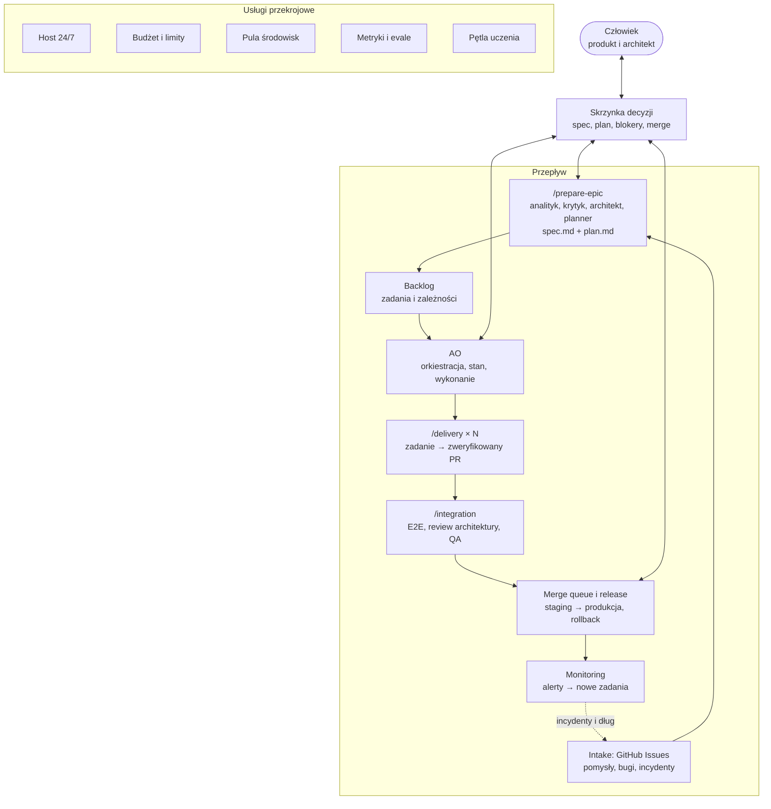

# Agentic Software House 24/7

## Kontekst

Większość kodu sklepu piszą agenci Claude Code. Dziś działają `/prepare-epic` (epik → `spec.md` i `plan.md` z manifestem zadań; poza epikami
`/brainstorm` i `/planner`), `/delivery` (jedno zadanie → zweryfikowany PR), `/integration`
(weryfikacja całego epiku) i agentic orchestrator (AO) w osobnym repozytorium `piotrp321/agentic-orchestrator`,
który prowadzi epik po jednym zadaniu naraz w gałęzi `epic/<epik>` i otwiera końcowy PR. Wdrożenie i monitoring są
ręczne, a blokery czekają na odpowiedź człowieka.
Chcemy, żeby system pracował autonomicznie przez całą dobę, a człowiek zatwierdzał tylko istotne decyzje.

## Decyzja

Docelowy przepływ:

`Intake → /prepare-epic → Backlog → AO → /delivery → /integration → Merge/Release → Monitoring`

Stan poszczególnych elementów, kolejność prac i kontrakt planu z backlogiem są
w [planie](../features/agentic-software-house/plan.md).

| Komponent | Jedna odpowiedzialność |
|---|---|
| Intake | Zbieranie pomysłów, bugów i incydentów w jednym miejscu: GitHub Issues (`epic`, `bug`, `ux`, `tech-debt`) |
| `/prepare-epic` | Przygotowanie epiku: `spec.md` i `plan.md` z jedną akceptacją użytkownika |
| Krytyk specyfikacji | `spec-critic`: braki, sprzeczności i przypadki brzegowe szkicu |
| `/brainstorm`, `/planner` | Narzędzia poza epikami: projekt funkcji → `spec.md`, dekompozycja → `plan.md` i manifest |
| Backlog | Trwałe zarządzanie zadaniami i zależnościami: definicje w manifeście `plan.md`, stan w AO |
| AO | Orkiestracja, stan i wykonywanie |
| `/delivery` | Implementacja pojedynczego zadania do zweryfikowanego PR |
| `/integration` | Integracja i weryfikacja całej funkcjonalności |
| Merge/Release | Merge zatwierdzonych zmian i wdrożenie z możliwością rollbacku |
| Monitoring | Zamiana alertów i incydentów w nowe zgłoszenia w intake |
| Agent tester | Test całego sklepu po merge'u epiku (`/sweep`), propozycje zgłoszeń `bug` do triage człowieka |
| Agent UX | Przegląd ekranów, wersji mobilnej i dostępności po merge'u epiku (`/sweep`) oraz w `/integration` przy zmianach frontów, propozycje zgłoszeń `ux` do triage człowieka |
| Skrzynka decyzji | Jedno miejsce na decyzje człowieka, z rekomendacją agenta i powiadomieniem |
| Budżet i limity | Limity subskrypcji, budżet na funkcję, priorytety kolejki |
| Pula środowisk | Worktree i stos Docker na zadanie, wolne porty, sprzątanie |
| Metryki i evale | Pomiar przepływu i jakości, benchmark zmian w skillach |
| Pętla uczenia | Retro po funkcji → zmiany w skillach i `CLAUDE.md` po evalach i akceptacji |

Zasady:

- Każdy komponent ma jedną, jasno określoną odpowiedzialność.
- Wykorzystujemy istniejący kod i skille (`/prepare-epic`, `/delivery`, AO, agentów z `.claude/agents/`, GitHub),
  zamiast tworzyć nowe frameworki.
- AO odpowiada za orkiestrację, stan i wykonywanie, a nie za decyzje architektoniczne. Decyzje spoza granic
  zadania wracają jako blokery do skrzynki decyzji.
- Człowiek zatwierdza istotne decyzje biznesowe i końcową integrację (merge funkcji, wdrożenie na produkcję).
- Docelowo system działa autonomicznie 24/7, z budżetami, limitami, backlogiem i obsługą blokerów.

## Uzasadnienie

- Wąskim gardłem pracy całodobowej jest człowiek, nie agenci. Zebrane w jednym miejscu decyzje z rekomendacją
  i jawna polityka autonomii pozwalają kolejce pracować dalej nad zadaniami bez blokera, zamiast stać.
- Jedna odpowiedzialność na komponent pozwala rozwijać, testować i wymieniać etapy osobno, a kontrakty między
  nimi (`spec.md`, manifest, wynik `/delivery`) są jawne i sprawdzalne.
- Deterministyczny AO w Pythonie pilnuje procesów, stanu i limitów taniej i pewniej niż model. Model podejmuje
  decyzje projektowe tam, gdzie są potrzebne.
- Istniejące narzędzia (GitHub Issues i PR, CI, skille) ograniczają ilość kodu infrastruktury do utrzymania.

## Konsekwencje

- Kontrakt wyniku `/delivery` jest interfejsem zewnętrznym dla AO. Zmiany w nim wymagają zmian po obu stronach.
- Każdy nowy komponent przechodzi zwykłą drogę: specyfikacja, plan, akceptacja, implementacja.
- Praca agentów zużywa limity subskrypcji wspólne z pracą interaktywną. Budżety i priorytety kolejki
  są warunkiem pracy nocnej.
- Zadania wykonywane równolegle potrzebują osobnych stosów Docker. Zasoby jednego hosta ograniczają
  liczbę zadań naraz.
- Autonomiczny merge bez człowieka jest dozwolony wyłącznie w granicach polityki autonomii zatwierdzonej
  przez użytkownika. Jedyny autonomiczny merge do `main` to PR ze specyfikacją i planem z `/prepare-epic`,
  po akceptacji użytkownika i zielonym CI.
