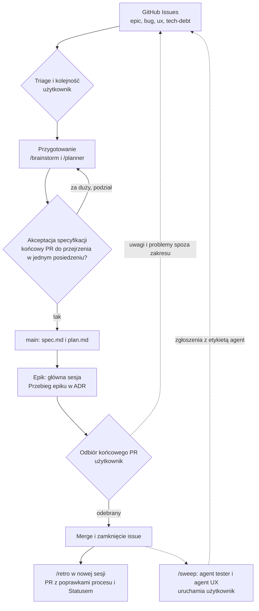

# Plan: Agentic Software House

Obowiązująca decyzja: [ADR](../../adr/agentic-software-house.md) (natywny przebieg epiku, bez AO). Ten plan ustala
role, backlog, przygotowanie epiku, kroki wdrożenia i kroki przejścia na pracę natywną.

Cel: użytkownik poświęca około godziny dziennie na decyzje, a agenci budują sklep według „Zakresu MVP”
z [wizji](../../vision.md). Godzina dziennie to cel do zmierzenia (krok 7), nie potwierdzony fakt.

Kroki 16–22 i rozszerzony krok 11 pokrywają kompetencje wymagane od Agentic SDLC Engineera, AI-Native Engineera
i Harness Engineera. Rozwiązania mają być praktyczne, mierzalne i przenośne do innych repozytoriów. Optymalizujemy
przede wszystkim czas zegarowy epiku, pilnując jakości, liczby napraw, interwencji człowieka i zużycia limitów.

## Status

Repozytorium nie ma skilli ani procedury uruchamiania AO, a epik ONCALL (krok 11) i pozostałe zaplanowane prace
związane z AO są wstrzymane (ADR, punkt 6 „Bez AO”).

W toku: brak epiku (przygotowany: PRODUCT-DATA, #772). Blokery: brak.
Ostatni zmergowany epik: API-INPUT-CONTRACT etap 2 (`api-input-2`, #305, końcowy PR #915, zmergowany 2026-11-25;
epik natywny z danymi pomiaru; 8 interwencji właściciela, 5 oczekiwań, łącznie 541 min czekania). Ostatni zmergowany
epik serii: DELIVERY etap 1 (#120, końcowy PR #819). Retro do zrobienia: brak (retro API-INPUT-CONTRACT etap 2: ten
PR). Otwartych issues z etykietą `agent` jest 145, zamkniętych 111.

Seria ASH v1.0 (specyfikacja `docs/features/ash-v1/spec.md`): trzy epiki prowadzone natywnie według „Przebiegu epiku”
w ADR, ocenianie metrykami i retrospektywami `/retro`. Seria jest w toku od założenia tagu `ash-v1.0` do retrospektywy
trzeciego epiku; w tym czasie pliki procesu zmienia tylko poprawka blokady albo zagrożenia, po zgodzie użytkownika
(reguła w ADR, koniec „Przebiegu epiku”).

| Seria ASH v1.0 | Stan |
|---|---|
| Stan serii | zakończona (tag `ash-v1.0` założony 2026-11-19; trzy epiki zmergowane; retrospektywa trzeciego epiku: PR #831) |
| Epiki serii | ABUSE-LIMITS (#181), ASYNC-RELIABILITY (#768), DELIVERY etap 1 (#120), w tej kolejności |
| Zmergowane epiki serii | ABUSE-LIMITS (#181, końcowy PR #802), ASYNC-RELIABILITY (#768, końcowy PR #811), DELIVERY etap 1 (#120, końcowy PR #819) |

Stan serii przyjmuje jedną z wartości: „przed startem”, „w toku”, „zakończona”.

Kroki przejścia na pracę natywną (obowiązują teraz, w tej kolejności):

| Krok | Zakres | Status |
|---|---|---|
| P1 | Zachowanie danych historycznych (transkrypty, stan i zrzuty AO) przed ich wygaśnięciem | zrobione (kopia poza repozytorium) |
| P2 | Pilne porządki z raportu audytu | w toku (pozostałości na dysku czekają na decyzję użytkownika) |
| P3 | DEMO-DATA kończy się w AO, ze skróconym `apps/api/CLAUDE.md` i nową polityką przeglądu | zrobione |
| P4 | Uproszczenie instrukcji i konfiguracji: `CLAUDE.md` główny i obszarów, agenci, `/planner`, `/brainstorm`, konfiguracja | zrobione |
| P5 | Seria ASH v1.0: trzy epiki natywnie (ABUSE-LIMITS → ASYNC-RELIABILITY → DELIVERY etap 1), każdy z punktem odniesienia i opisem końcowego PR | zrobione: trzy epiki serii zmergowane natywnie (ABUSE-LIMITS, końcowy PR #802; ASYNC-RELIABILITY, #811; DELIVERY etap 1, #819); seria zakończona retrospektywą DELIVERY (PR #831) |
| P6 | Decyzja o archiwizacji AO i usunięciu jego narzędzi | decyzja w ADR (punkt 6 „Bez AO”); usuwanie narzędzi AO z repozytorium w toku |

Tabela niżej to stan kroków wdrożenia procesu; opisy kroków są w sekcji „Kroki wdrożenia”.

| Krok | Zakres | Status |
|---|---|---|
| 2 | Ten plan, zasada backlogu w `CLAUDE.md` i ADR | zrobione |
| 3 | Poprawki procesu w `shop` | zrobione |
| 4 | Backlog w GitHub Issues | zrobione |
| 7 | Pierwszy epik przez cały proces | zrobione |
| 9 | Agent tester i agent UX | zrobione |
| 10 | Przed publicznym demo: bezpieczeństwo i wydajność | zrobione (epik HARDENING #267, końcowy PR #402 zmergowany) |
| 11 | Po MVP: release, monitoring i dyżur agenta | wstrzymane (epik SENTRY zmergowany, końcowy PR #539; dyżur i hypercare, epik ONCALL, wstrzymane) |
| 12 | `/sweep` po merge'u epiku | ręcznie: `/sweep <epik>` uruchamia użytkownik; automatycznego uruchamiania nie ma, bo AO nie jest częścią repozytorium |
| 15 | Retrospektywa po epiku (`/retro`) i aktualny „Status” | zrobione; zweryfikowane: pełne przebiegi `/retro` po epikach natywnych SMALL-FIXES (#799) i ASH-V1 (#801) |
| 16 | Bezpieczeństwo agentów | zrobione (epik AGENT-SECURITY #494, końcowy PR #548 zmergowany) |
| 17 | Evale agentów i workflowów | wstrzymane |
| 18 | Pomiar, koszty i optymalizacja | wstrzymane (epik METRICS #496 zrobiony, końcowy PR #674 zmergowany: pomiar epiku, `tools/metrics`; epik TELEMETRY #577 zrobiony, końcowy PR #721 zmergowany: telemetria Claude Code do lokalnego stosu) |
| 19 | Praca równoległa | 19b, zadania jednej fali naraz: działa natywnie (`docs/features/parallel-work/spec.md`); 19a, epiki naraz przez bramkę: brak, AO nie jest częścią repozytorium |
| 20 | Asystent zakupowy i serwer MCP katalogu (osobny epik poza MVP) | wstrzymane |
| 21 | Dokumentacja wdrożenia procesu i studium przypadku | wstrzymane |
| 22 | Porównanie Claude Code i OpenAI Codex | wstrzymane |

## Role

Testerów i projektantów UX nie zatrudniamy: obie role pełnią agenci. Człowiekiem jest tylko właściciel produktu.

| Dział | Rola | Kto | Stan |
|---|---|---|---|
| Produkt | Właściciel produktu: co budujemy, kolejność, triage, odbiór | użytkownik | działa |
| Analiza i projekt | Analityk: specyfikacja | `/brainstorm` z użytkownikiem | działa |
| | Architekt: ADR, review architektury epiku | `architecture-reviewer` w przeglądzie całej zmiany, zlecany przez główną sesję | działa |
| | UX: ekrany, wersja mobilna, dostępność | `ux-reviewer` w `/sweep` i w przeglądzie całej zmiany (tryb `integration`) | działa |
| Planowanie | Plan i zadania | `/planner` | działa |
| | Koordynacja epiku: zadania, przeglądy, stan, PR | główna sesja Claude Code (ADR, „Przebieg epiku”) | działa |
| | Praca równoległa: zadania jednej fali naraz | główna sesja według `parallel_with` manifestu (`docs/features/parallel-work/spec.md`) | działa |
| Wytwarzanie | Developer: zadanie z TDD | `developer` zlecany przez główną sesję | działa |
| | Code review zadania | `code-reviewer` zlecany przez główną sesję | działa |
| Jakość | QA epiku | `qa-adversarial` w przeglądzie całej zmiany | działa |
| | Tester całego sklepu | `tester` w `/sweep` uruchamianym ręcznie przez użytkownika | działa |
| | Bezpieczeństwo i wydajność | ustalane w kroku 10 | krok 10 |
| | Bezpieczeństwo agentów: niezaufane wejścia, izolacja uprawnień i sekretów, testy obejścia | sandbox i reguły w `shop` | krok 16 |
| | Evale agentów na prawdziwych zadaniach i porównanie wariantów agenta | EVALS 2.0: `tools/evals-pilot` (`code-reviewer`), uruchamiane ręcznie za zgodą właściciela | krok 17 |
| Backlog i proces | Retrospektywa epiku: poprawki procesu i „Status” planów | `/retro` z agentem `retro-analyst`, uruchamiany przez użytkownika w nowej sesji po merge'u | działa |
| | Pomiar czasu, kosztu i jakości z decyzjami optymalizacyjnymi | `tools/metrics` (`tools/metrics/README.md`), wołany przez sesję prowadzącą epik; telemetria Claude Code w lokalnym stosie na Macu (TELEMETRY #577) | krok 18 |
| Wydanie i utrzymanie | Release na publiczne demo, rollback | k3s i Argo CD z `docs/vision.md` | krok 11 |
| | Monitoring → issues, dyżur i hypercare | agent dyżurny: Sentry i Grafana Cloud przez MCP, tylko odczyt | krok 11 |

## Proces

Epik prowadzi główna sesja Claude Code według „Przebiegu epiku” w [ADR](../../adr/agentic-software-house.md); ta
sekcja opisuje backlog, przygotowanie epiku, odbiór i przeglądy po merge'u.

1. **Backlog: GitHub Issues** w `piotrp321/shop`.
   - Etykieta `epic` to epik z roadmapy (spójna grupa zmian z własną specyfikacją), `bug` to błąd, `ux` to problem
     użyteczności albo wyglądu, `tech-debt` to porządki w kodzie, bazie albo dokumentacji bez zmiany zachowania.
   - Każde zgłoszenie należy do jednego backlogu: `app` (sklep, API, panel i ich infrastruktura), `ash` (proces,
     agenci, skille, narzędzia i CI repozytorium) albo `ao-frozen` (AO z repozytorium
     `piotrp321/agentic-orchestrator`, bez priorytetu). Zgłoszenie epiku zawiera listę swoich pozycji
     i identyfikatory znalezisk z raportów w `docs/reports/`.
   - Zgłaszają: użytkownik, agent tester i agent UX. Zgłoszenia agentów mają etykietę `agent` i limit
     na jeden przebieg. Do backlogu trafiają dopiero po triage użytkownika.
   - Zgłoszenia `bug`, `ux` i `tech-debt` mają pola: środowisko, kroki odtworzenia (jeden krok w linii), wynik
     oczekiwany i faktyczny, kryterium akceptacji, niewiadome. Dla `bug` i `ux` jest formularz
     w `.github/ISSUE_TEMPLATE/`, agenci wypełniają te same pola. Zgłoszenie z brakami dostaje etykietę
     `needs-info` i nie idzie do przygotowania.
   - Kolejność ustala użytkownik na tablicy GitHub Projects
     [„Backlog sklepu”](https://github.com/users/piotrp321/projects/1): epik na górze idzie pierwszy. Na tablicy są
     tylko epiki i pozycje do zrobienia przed nimi; pole „Backlog” odróżnia aplikację od ASH.
2. **Przygotowanie (użytkownik).**
   - Issue z góry listy → `/brainstorm` → `spec.md`, `/planner` → `plan.md`.
   - Decyzje produktowe (zakres, reguły, limity, zachowanie klienta) podejmuje wyłącznie użytkownik. Agenci ich
     nie rozstrzygają między sobą. Zbierają je w jedną listę pytań, każde z rekomendacją. Użytkownik dostaje
     pytania raz, przed akceptacją.
   - Akceptacja jest jedna: specyfikacja z pozycjami użytkownika z „Wymaganych przed startem” i jedno pytanie, czy
     końcowy PR da się przejrzeć w jednym posiedzeniu, z liczbą zadań i dotkniętymi aplikacjami. Jeśli PR jest
     za duży, epik dzielimy na dwa,
     mergowane po kolei. Rozmiar pojedynczych zadań zostaje bez zmian. Podziału na zadania użytkownik nie
     akceptuje: `plan.md` musi przejść walidator manifestu.
   - Nie przygotowujemy wszystkich epików naraz, bo specyfikacja opisuje kod, którego jeszcze nie ma.
   - Specyfikacja ma sekcję „Wymagane przed startem”: sekrety, konta, usługi zewnętrzne, uprawnienia i decyzje
     infrastrukturalne potrzebne zadaniom. Przy akceptacji użytkownik potwierdza, że jego pozycje są gotowe albo
     będą przed startem epiku, żeby taki bloker nie wyszedł dopiero w trakcie zadania.
   - Zgłoszenie `ux` zawsze idzie przez przygotowanie epiku. Drobne zgłoszenia `bug`
     i `tech-debt` trafiają razem do jednego epiku poprawek: krótka specyfikacja, jedno zadanie na issue.
   - Zaakceptowane `spec.md` i `plan.md` trafiają do `main` przez PR.
3. **Wykonanie.** Epik prowadzi główna sesja Claude Code według „Przebiegu epiku” w ADR, od gałęzi epiku z draft PR
   do `main` do przekazania do retro po merge'u.
4. **Decyzje w trakcie epiku.** Szczegóły implementacji sesja rozstrzyga sama i wpisuje do „Decyzji bez pytania”
   opisu końcowego PR. Istotne decyzje DDD i architektury przedstawia użytkownikowi przed implementacją (główny
   `CLAUDE.md`). Powtarzający się bloker naprawiamy w `/brainstorm` albo w `CLAUDE.md`.
5. **Odbiór (użytkownik).**
   - Odbiór to przeczytanie opisu końcowego PR (tabela kryteriów, odroczone uwagi, decyzje bez pytania; ADR,
     „Przebieg epiku”, krok 7) i merge (squash). Issues z linii `Issues:` specyfikacji zamyka `Closes #N` w opisie PR.
   - Problem spoza zakresu albo większy: nowe issue `bug` lub `ux`. Epik mergujemy bez tej poprawki, o ile
     niczego na `main` nie psuje.
6. **Przegląd całego sklepu (`/sweep [epik]`).** Uruchamia go ręcznie użytkownik.
   Agent tester i agent UX przechodzą cały sklep na świeżym stosie z `main`: krytyczne ścieżki z sekcji „Testy”
   w `docs/vision.md` i nową funkcję ze specyfikacji, jako klient i jako pracownik. Przed zaproponowaniem zgłoszenia
   sprawdzają otwarte issues, żeby nie dublować. Propozycje trafiają do triage (punkt 1).
7. **Retrospektywa (15, `/retro [epik]`).** Po merge'u użytkownik uruchamia `/retro <epik>` w nowej sesji. Skrypt
   `retro.py` zbiera z danych epików natywnych (plik przebiegu i rekord `tools/metrics`, opis końcowego PR), historii
   przebiegów AO (tylko do odczytu) i raportów `/sweep` **incydenty**. Agent `retro-analyst` grupuje je w problemy
   i szuka przyczyny w instrukcjach procesu. Wynik:
   - jeden wspólny PR do `main` z gałęzi `retro/*` (merguje użytkownik): poprawki procesu w `shop` (`CLAUDE.md`,
     skille, agenci, specyfikacje skilli), każda w osobnym commicie z dowodami, przyczyną i sposobem sprawdzenia;
     kolejne retro dopisują do otwartego PR. Próg: co najmniej dwa różne incydenty albo jeden naprawczy (wymagał
     działania człowieka z powodu nieprzewidzianej awarii); poprawka, po której problem wrócił, jest oznaczona jako
     nieskuteczna;
   - aktualna sekcja „Status” tego planu;
   - propozycje issues (najwyżej 3): problem w AO jako issue w `piotrp321/agentic-orchestrator`, poprawka
     wymagająca kodu w `shop` jako `tech-debt` z etykietą `agent`, problem z otwartym issue jako komentarz do
     niego. Issues i komentarze powstają po „tak” użytkownika; problem odrzucony świadomie nie wraca bez nowego
     incydentu.

   Retro do zrobienia to lista wyliczana z danych (`retro.py pending`: zmergowane epiki bez stanu `done` albo
   `skipped`), więc odroczone (limit, brak `gh`) wraca przy następnym `/retro` bez argumentu. Opis:
   `docs/features/retro/spec.md`.

## Kroki wdrożenia

2. **Plan i zasada backlogu.** Ten plan i zasada backlogu w `CLAUDE.md`: GitHub Issues jako intake, role agenta
   testera i agenta UX. Jeden PR.
3. **Poprawki procesu w `shop`.** Formularze `bug` i `ux` w `.github/ISSUE_TEMPLATE/`, kontrole istniejących
   testów, zakresu i RED w `code-reviewer`, sekcja „Decyzje bez pytania” w opisie PR i lista odbioru w raporcie
   `/integration`.
4. **Backlog.** Etykiety `epic`, `bug`, `ux`, `tech-debt`, `needs-info` i `agent` są założone. Epiki z niezrobionych
   punktów „Zakresu MVP” to issues #88–#97, w kolejności na tablicy „Backlog sklepu”.
7. **Pierwszy epik.** Issue z góry backlogu przechodzi cały proces, od przygotowania do odbioru, razem z pomiarem
   epiku (`tools/metrics`). Każdy kolejny epik idzie tym samym procesem.
9. **Agent tester i agent UX.** Gotowe: agent tester i agent UX (`.claude/agents/`), skill `/sweep` uruchamiany
   ręcznie, agent UX w przeglądzie całej zmiany epików z frontem (tryb `integration`), etykieta `agent`, limit pięciu
   propozycji na przebieg i sprawdzanie duplikatów. Agent UX ocenia w sklepie użyteczność, dostępność,
   responsywność (375, 768 i 1440 px), spójność komponentów i jakość wizualną (zgodność z wybranym kierunkiem
   i tokenami, gdy kierunek jest w repo). Opis: `docs/features/agent-tester-ux/spec.md`.
10. **Przed publicznym demo: bezpieczeństwo i wydajność.** Przegląd bezpieczeństwa całego sklepu i testy
   obciążeniowe względem „Wymagań niefunkcjonalnych” z `docs/vision.md`. Zakres i narzędzia ustala specyfikacja
   przed demo.
11. **Po MVP: release, monitoring i dyżur agenta.** Publiczne demo zgodnie z `docs/vision.md` (k3s, Argo CD,
   rollback). Po epiku SENTRY agent dyżurny:
   - ma minimalne uprawnienia, technicznie ograniczone do odczytu: Sentry i Grafana Cloud przez ich serwery MCP,
     klaster przez istniejące cele `make -C infra/k8s`; dostępność i możliwości integracji MCP sprawdzamy przed
     zatwierdzeniem specyfikacji;
   - diagnozuje i koreluje błędy Sentry, alerty Grafany i stan klastra, proponuje naprawy i przygotowuje issues `bug`
     z etykietą `agent`, które przechodzą triage użytkownika (jak propozycje `/sweep`);
   - po wdrożeniu epiku prowadzi hypercare: porównuje błędy nowego wydania z poprzednim i wysyła push z rekomendacją;
   - nie wykonuje rollbacku ani innych operacji produkcyjnych: robi je wyłącznie użytkownik.

Kroki 12 i 15 domykają pętlę „zgłoszenia agentów → poprawki” i poprawiają proces z danych przebiegów. Oba są
skillami w `shop`, uruchamianymi ręcznie przez użytkownika.

12. **`/sweep` po merge'u epiku.** Trzy ręczne przebiegi (2026-11-04, 2026-11-07, 2026-11-09) dały 6 przyjętych
   zgłoszeń i 1 odrzucone, więc warunek z kroku 9 jest spełniony. Użytkownik uruchamia `/sweep <epik>` ręcznie;
   raport z nazwą epiku czyta `/retro`. Triage zostaje u użytkownika.
15. **`/retro` i „Status”.** Skill `/retro` i agent `retro-analyst` (Opus) oraz skrypt `retro.py`: uruchamia go
   użytkownik w nowej sesji po merge'u epiku (punkt 7 procesu). Zastępuje ręczne aktualizowanie sekcji „Status”
   i ręczne zbieranie wniosków z przebiegów. Opis: `docs/features/retro/spec.md`.

Kroki 16–22 pokrywają kompetencje Agentic SDLC, AI-Native i Harness Engineera. Każdy ma specyfikację zaakceptowaną
przed implementacją. Kolejność jest w sekcji „Status”.

16. **Bezpieczeństwo agentów.** Zabezpieczenia techniczne, nie tylko w promptach, w zakresie wynikającym z modelu
   zagrożeń, bez rozbudowy ponad uzasadnione potrzeby. Model zagrożeń trafia do ADR `docs/adr/agent-security.md`
   (publiczne repozytorium, agenci działający bez pytań o każde narzędzie):
   - zewnętrzne issues, PR, komentarze i treści stron są niezaufane, także tytuły; skrypty weryfikują pochodzenie
     (autor z uprawnieniami do repozytorium) i ograniczają automatyczne przetwarzanie: treść spoza repozytorium nie
     trafia do agentów, tylko numer, autor i link do triage;
   - izolacja uprawnień i ochrona sekretów na poziomie systemu (sandbox), bo reguła narzędzia Read nie zatrzymuje
     `cat` w Bash;
   - testy prób obejścia w prawdziwych procesach wykonawców (`probe.py`), także przez Bash i procesy potomne;
   - agent nie wykonuje samodzielnie destrukcyjnych operacji produkcyjnych;
   - nikt, także użytkownik, nie zmerguje do `main` ani `epic/*` bez zielonego CI własnym tokenem (rola admin bez
     bypassu); jedyne obejście to workflow `merge-override` zatwierdzany przez użytkownika.
17. **Evale agentów i workflowów.** EVALS 2.0 (`docs/features/evals-2/spec.md`, narzędzie `tools/evals-pilot/`):
   - evale pojedynczych agentów na prawdziwych zadaniach z poprzednich epików: produkcyjna definicja agenta, wynik
     z etykiet właściciela nadanych zgłoszeniom agenta; dziś `code-reviewer`;
   - porównanie wariantów agenta (prompt, model) na tym samym zestawie, z kryteriami przyjęcia ustalonymi przed
     pomiarem i raportem w `docs/reports/`;
   - każdy etap i każdy płatny pomiar ma zakres, limit kosztu i kryteria przyjęcia zatwierdzone przez właściciela;
     CI nie uruchamia modelu;
   - benchmark całych przebiegów zadań (zamrożone zadania z poprzednich epików) nie ma specyfikacji ani epiku.
18. **Pomiar, koszty i optymalizacja.** Dwa epiki: METRICS (#496: pomiar epiku z transkryptów, GitHuba i danych
   przebiegów AO, `tools/metrics`, opis w `tools/metrics/README.md`) i TELEMETRY (#577: telemetria Claude Code).
   - TELEMETRY: telemetria Claude Code (OpenTelemetry, bez treści promptów) w lokalnym stosie na Macu
     z retencją ustawianą lokalnie, dłuższą niż 14 dni darmowego planu Grafana Cloud.
   - METRICS: pomiar każdego epiku: czas zegarowy (miara główna), czas rzeczywistej pracy, oczekiwania i blokad; koszt
     i tokeny na agenta, model i zadanie; ponowienia, naprawy i konflikty; czas testów, selftestów i integracji;
     interwencje człowieka; regresje i błędy po merge'u.
   - METRICS: szacunkowa wartość tokenów (ceny API z CLI) osobno od faktycznego kosztu subskrypcji (punkty procentowe limitu).
   - METRICS: `/retro` kończy się konkretnymi decyzjami optymalizacyjnymi (model dla roli z evali kroku 17 i kosztu,
     podział planu, równoległość), a nie samym zestawieniem.
19. **Praca równoległa.** Naraz idą zadania jednej fali, które plan dopuścił do pracy równoległej (`parallel_with`
   manifestu); ile z nich pójdzie naraz, rozstrzyga sesja prowadząca epik według izolacji i zasobów (ADR, „Przebieg
   epiku”, krok 3; `docs/features/parallel-work/spec.md`). Symulacja na 20 epikach z bazy AO: dwa zadania naraz
   skracają czas pracy wykonawców o 18%, DEPLOY-OPS o 26%, epiki poprawek o 35–37%. `/planner` maksymalizuje
   bezpieczną równoległość: fale według granic odpowiedzialności, `paths` i rzeczywistych zależności, bez dzielenia
   kodu wyłącznie dla równoległości; wspólne ścieżki pary jednej fali to wada planu albo praca szeregowa z powodem
   w planie.
20. **Asystent zakupowy i serwer MCP katalogu.** Osobny, niezależny epik poza „Zakresem MVP”,
   który nie blokuje MVP (zmianę `docs/vision.md` robi przygotowanie epiku). Asystent w sklepie sięga do wyszukiwarki
   i karty produktu przez tool calling i nasz serwer MCP katalogu (tylko odczyt); serwer jest jedyną drogą asystenta
   do katalogu i może z niego korzystać każdy zewnętrzny agent. Epik pokazuje tool calling, bezpieczeństwo (prompt
   injection od klientów, brak danych osobowych w promptach), obsługę błędów, evale odpowiedzi, monitoring i kontrolę
   kosztów (limit na demo). Bez embeddingów całego katalogu, więc skaluje się z obecnym Elasticsearchem. Klucz Claude
   API z miesięcznym limitem to pozycja użytkownika w „Wymaganych przed startem”.
21. **Dokumentacja wdrożenia procesu i studium przypadku.** Dokumentacja pozwalająca wdrożyć proces w innym
   repozytorium, diagram architektury, rzeczywiste metryki z kroku 18, studium przypadku i opis najważniejszych
   decyzji technicznych. Raporty z liczbami trafiają do `docs/reports/`.
22. **Porównanie Claude Code i OpenAI Codex.** Na benchmarku przebiegów zadań z kroku 17 (bez specyfikacji): jakość,
   czas, koszt i potrzeba ingerencji człowieka; raport w `docs/reports/`. Bez kupowania dodatkowych usług na etapie
   planowania; konto do uruchomienia Codex ustala specyfikacja kroku.

Plan usuwamy po ostatnim kroku.

## Świadomie poza planem

Skrzynka decyzji, polityka autonomii jako plik, budżet na funkcję, merge queue, automatyczne zamienianie issue
w zadania, agent decydujący o produkcie, automatyczny merge kodu do `main`, przygotowanie wszystkich epików naraz.
Wracają tylko wtedy, gdy przebiegi pokażą, że czegoś z tego brakuje, i użytkownik o tym zdecyduje.

## Kontrakt planu i backlogu

Styk backlog → `/planner` → główna sesja. Format manifestu i jego walidator są w `.claude/skills/planner/`
(`schema_version: 1`). Manifest czyta sesja prowadząca epik; `risk` z manifestu to podpowiedź, wiąże klasyfikacja
zadania przez sesję prowadzącą.

1. **Jedno źródło na rodzaj danych.** Co budujemy i w jakiej kolejności: issue. Definicja zadania (ID, tytuł,
   zakres, kryteria akceptacji, ryzyko, zależności, specyfikacja): tylko manifest. Stan prac: tylko sekcja „Status”
   planu funkcji. Issue nie zawiera definicji zadań.
2. **Plan wiążący = plan na `origin/main`.** Zaakceptowany plan i jego specyfikacja trafiają do `main` przed startem
   epiku, a gałąź epiku startuje od `origin/main`, więc każda gałąź zadania zawiera specyfikację.
3. **Zmiana planu po akceptacji** wymaga ponownej akceptacji (zasada `/planner`).
4. **Gotowość zadania zależnego.** Zadanie rusza, gdy wszystkie jego zależności są zmergowane do gałęzi epiku.
5. **Wersjonowanie.** Każda zmiana pól manifestu podnosi `schema_version` i wymaga zmiany walidatora `/planner`.

## Punkty zatrzymania

- **Każdy epik:** przed startem epiku użytkownik akceptuje specyfikację i rozmiar końcowego PR,
  a `plan.md` przechodzi walidator manifestu.
- **Merge do `main`:** końcowy PR epiku merguje użytkownik albo sesja na jego wyraźne polecenie w rozmowie, które
  wskazuje ten PR (także z telefonu), po zielonym CI. Każde rozszerzenie autonomii wymaga jego jawnej zgody.
- **Decyzje DDD i architektury:** istotne decyzje DDD (agregaty, value objecty, granice modułów, persystencja) oraz
  zmiany zasad, zależności, specyfikacji i architektury sesja przedstawia użytkownikowi przed implementacją.
- **Wdrożenie i produkcja:** wdrożenie rusza tylko na wyraźne polecenie użytkownika w rozmowie; rollback i inne
  operacje produkcyjne wykonuje wyłącznie użytkownik; agenci mają do produkcji dostęp tylko do odczytu.
- **Krok 4:** issues epików powstają dopiero po akceptacji listy.
- **Kroki 9–22:** specyfikacja każdego kroku zaakceptowana przed implementacją.
- **Zgłoszenia agentów:** trafiają do backlogu dopiero po triage użytkownika.
