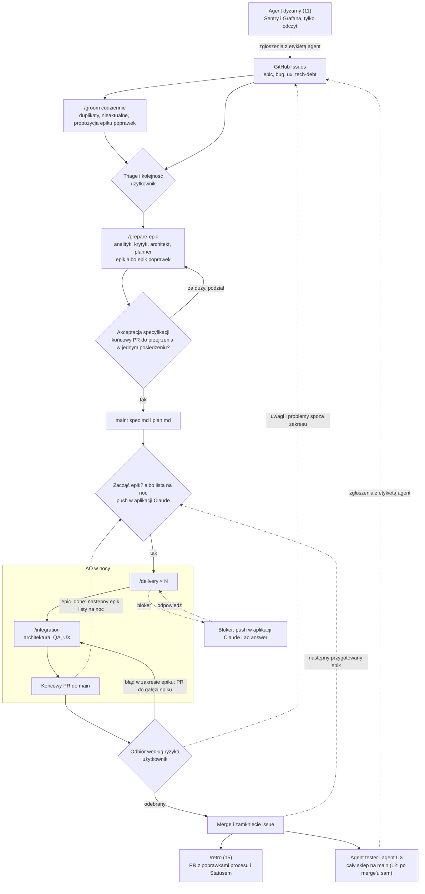

# Plan: Agentic Software House

Docelowa architektura i zasady: [ADR](../../adr/agentic-software-house.md). Ten plan ustala role, proces pracy
i kroki wdrożenia. AO jest zamrożone po v0.3.1: zmienia się tylko wtedy, gdy prawdziwy przebieg epiku stoi,
najmniejszą poprawką i za zgodą użytkownika. Wyjątek zatwierdzony przez użytkownika: równoległe zadania epiku
(krok 19b, piotrp321/agentic-orchestrator#50). Nowe role powstają jako skille i agenci w `shop`, bez kodu AO.

Cel: użytkownik poświęca około godziny dziennie na decyzje, a agenci budują sklep według „Zakresu MVP”
z [wizji](../../vision.md). Godzina dziennie to cel do zmierzenia (krok 7), nie potwierdzony fakt.

Kroki 16–22 i rozszerzony krok 11 pokrywają kompetencje wymagane od Agentic SDLC Engineera, AI-Native Engineera
i Harness Engineera. Rozwiązania mają być praktyczne, mierzalne i przenośne do innych repozytoriów. Optymalizujemy
przede wszystkim czas zegarowy epiku, pilnując jakości, liczby napraw, interwencji człowieka i zużycia limitów.

## Status

W toku przez `/ao-run`: DEMO-DATA (#482); przygotowane do startu: SENTRY (#180), AGENT-SECURITY (#494) i EVALS
(#495). Kolejność epików jest na tablicy „Backlog sklepu”. Blokery: brak. Ostatni zmergowany epik: ADMIN-DESIGN
(końcowy PR #503; 1 interwencja, 1 czekanie na użytkownika, razem 20 min, 2 ręczne poprawki). Retro do zrobienia:
brak (retro ADMIN-DESIGN w tym PR).
Krok 7: CART-FIXES (#88)
przeszedł cały proces, od `/prepare-epic` do odbioru (końcowy PR #112): 30 minut użytkownika (szacunek użytkownika,
nie pomiar), 0 interwencji, 0 ręcznych poprawek, 4 h przebiegu AO (5 zadań), koszt 14,45 USD według Claude CLI.
Kroki 12–15 domykają pętlę zgłoszeń agentów: otwartych issues z etykietą `agent` jest 77, zamkniętych 36.
Kolejność kroków 16–22: 19a zrobione (pomiar dwóch pierwszych par epików do zrobienia), teraz 16, 17 i 18; 19b po
dwóch parach epików 19a; 11 po epiku SENTRY; na końcu 20, 21 i 22.

| Krok | Zakres | Status |
|---|---|---|
| 1 | AO v0.3.1 i zamrożenie AO | zrobione |
| 2 | Ten plan, zasada backlogu w `CLAUDE.md` i ADR | zrobione |
| 3 | Poprawki procesu w `shop` | zrobione |
| 4 | Backlog w GitHub Issues | zrobione |
| 5 | Powiadomienia i kolejka epików przez aplikację Claude | zrobione (sprawdzenie w kroku 7) |
| 6 | Przygotowanie epiku jednym skillem `/prepare-epic` | zrobione |
| 7 | Pierwszy epik przez cały proces | zrobione |
| 8 | Nocna kolejka kilku epików | zrobione (sprawdzenie: pierwsza noc) |
| 9 | Agent tester i agent UX | zrobione |
| 10 | Przed publicznym demo: bezpieczeństwo i wydajność | zrobione (epik HARDENING #267, końcowy PR #402 zmergowany) |
| 11 | Po MVP: release, monitoring i dyżur agenta | do zrobienia (dyżur i hypercare po epiku SENTRY) |
| 12 | `/sweep` uruchamiany przez `/ao-run` po merge'u epiku | zrobione; kryterium 7 potwierdzone: `/sweep` po merge'u LIGHTHOUSE i HARDENING (raporty z nazwą epiku); kryteria 8–9 bez dowodu w przebiegach |
| 13 | Agent porządkujący backlog (`/groom`) | zrobione (zadanie zaplanowane o 8:00 w aplikacji Claude; pierwsza lista z 2026-11-09 wykonana po decyzji użytkownika) |
| 14 | Epik poprawek przygotowany bez użytkownika aż do pytań | zrobione, niezweryfikowane na prawdziwym epiku (sprawdza pierwszy epik `-FIXES` po QUALITY-FIXES) |
| 15 | Retrospektywa po epiku (`/retro`) i aktualny „Status” | zrobione, niezweryfikowane na prawdziwym epiku (sprawdza pierwszy merge epiku po merge'u RETRO i pierwszy przebieg `/retro visual-design`) |
| 16 | Bezpieczeństwo agentów | do zrobienia |
| 17 | Evale agentów i workflowów | do zrobienia |
| 18 | Pomiar, koszty i optymalizacja | do zrobienia |
| 19 | Praca równoległa | 19a: zrobione, pomiar dwóch pierwszych par epików do zrobienia; 19b: po dwóch parach epików 19a |
| 20 | Asystent zakupowy i serwer MCP katalogu (osobny epik poza MVP) | do zrobienia |
| 21 | Dokumentacja wdrożenia procesu i studium przypadku | do zrobienia |
| 22 | Porównanie Claude Code i OpenAI Codex | do zrobienia |

## Role

Testerów i projektantów UX nie zatrudniamy: obie role pełnią agenci. Człowiekiem jest tylko właściciel produktu.

| Dział | Rola | Kto | Stan |
|---|---|---|---|
| Produkt | Właściciel produktu: co budujemy, kolejność, triage, odbiór | użytkownik | działa |
| Analiza i projekt | Analityk: specyfikacja | `/brainstorm` z użytkownikiem, w `/prepare-epic` | działa |
| | Krytyk specyfikacji: braki, sprzeczności, przypadki brzegowe | `spec-critic` w `/prepare-epic` | działa |
| | Architekt: review specyfikacji | `architecture-reviewer` w `/prepare-epic` | działa |
| | Architekt: ADR, review architektury epiku | `architecture-reviewer` w `/integration` | działa |
| | UX: ekrany, wersja mobilna, dostępność | `ux-reviewer` w `/sweep` i w `/integration` | działa |
| Planowanie | Plan i zadania | `/planner`, w `/prepare-epic` | działa |
| | Koordynacja: przebieg nocny, stan, PR | AO | działa |
| | Kolejka epików: następny epik po merge'u i lista na noc | `/ao-run` w sesji z Remote Control | działa, lista na noc do sprawdzenia w pierwszej nocy |
| | Praca równoległa: epiki naraz i zadania fali naraz, bramka ryzyka | `/ao-run` z bramką `night_queue.py gate` (19a), AO `--max-parallel` (19b) | 19a działa, pomiar dwóch par do zrobienia; 19b: krok 19 |
| Wytwarzanie | Developer: zadanie z TDD | `developer` w `/delivery` | działa |
| | Code review zadania | `code-reviewer` w `/delivery` | działa |
| Jakość | QA epiku | `qa-adversarial` w `/integration` | działa |
| | Tester całego sklepu | `tester` w `/sweep`, uruchamiany przez `/ao-run` po merge'u | działa |
| | Bezpieczeństwo i wydajność | ustalane w kroku 10 | krok 10 |
| | Bezpieczeństwo agentów: niezaufane wejścia, izolacja uprawnień i sekretów, testy obejścia | sandbox i reguły w `shop` | krok 16 |
| | Evale agentów i workflowów, benchmark i kryteria regresji | `make evals` | krok 17 |
| Backlog i proces | Porządkowanie backlogu: duplikaty, nieaktualne zgłoszenia, propozycje epików poprawek | `/groom` z agentem `backlog-groomer`, codziennie o 8:00 | działa |
| | Retrospektywa epiku: poprawki procesu i „Status” planów | `/retro` z agentem `retro-analyst`, uruchamiany przez `/ao-run` po `/sweep` | działa, niezweryfikowane na prawdziwym epiku |
| | Pomiar czasu, kosztu i jakości z decyzjami optymalizacyjnymi | pomiar epiku i telemetria Claude Code w Grafana Cloud | krok 18 |
| Wydanie i utrzymanie | Release na publiczne demo, rollback | k3s i Argo CD z `docs/vision.md` | krok 11 |
| | Monitoring → issues, dyżur i hypercare | agent dyżurny: Sentry i Grafana Cloud przez MCP, tylko odczyt | krok 11 |

## Proces

Stały proces każdego epiku. Elementy, które jeszcze nie działają, mają w nawiasie numer kroku wdrożenia.

1. **Backlog: GitHub Issues** w `piotrp321/shop`.
   - Etykieta `epic` to funkcja z „Zakresu MVP”, `bug` to błąd, `ux` to problem użyteczności albo wyglądu,
     `tech-debt` to porządki w kodzie, bazie albo dokumentacji bez zmiany zachowania.
   - Zgłaszają: użytkownik, agent tester i agent UX. Zgłoszenia agentów mają etykietę `agent` i limit
     na jeden przebieg. Do backlogu trafiają dopiero po triage użytkownika.
   - Zgłoszenia `bug`, `ux` i `tech-debt` mają pola: środowisko, kroki odtworzenia (jeden krok w linii), wynik
     oczekiwany i faktyczny, kryterium akceptacji, niewiadome. Dla `bug` i `ux` jest formularz
     w `.github/ISSUE_TEMPLATE/`, agenci wypełniają te same pola. Zgłoszenie z brakami dostaje etykietę
     `needs-info` i nie idzie do przygotowania.
   - Kolejność ustala użytkownik na tablicy GitHub Projects
     [„Backlog sklepu”](https://github.com/users/piotrp321/projects/1): epik na górze idzie pierwszy.
   - `/groom` codziennie o 8:00 (zadanie zaplanowane w aplikacji Claude) albo ręcznie przegląda otwarte zgłoszenia
     i daje użytkownikowi jedną listę propozycji: duplikaty, zgłoszenia nieaktualne wobec kodu na `main` (z dowodem),
     braki, etykiety i jeden epik poprawek. Zmiany w GitHubie wykonuje dopiero po „tak” użytkownika
     (`docs/features/groom/spec.md`).
2. **Przygotowanie (użytkownik, w dzień).**
   - Issue z góry listy → `/prepare-epic` → `spec.md` i `plan.md`.
   - `/prepare-epic` prowadzi kolejno:
     - analityka według zasad `/brainstorm`: discovery i szkic specyfikacji;
     - krytyka i `architecture-reviewer`: sprawdzają szkic, nie użytkownika;
     - poprawki techniczne w szkicu;
     - `/planner`.
   - Decyzje produktowe (zakres, reguły, limity, zachowanie klienta) podejmuje wyłącznie użytkownik. Agenci ich
     nie rozstrzygają między sobą. Zbierają je w jedną listę pytań, każde z rekomendacją. Użytkownik dostaje
     pytania raz, przed akceptacją.
   - Akceptacja jest jedna: specyfikacja z pozycjami użytkownika z „Wymaganych przed startem” i jedno pytanie, czy
     końcowy PR da się przejrzeć w jednym posiedzeniu.
     Skill podaje do tego liczbę zadań i dotknięte aplikacje. Jeśli PR jest za duży, epik dzielimy na dwa,
     mergowane po kolei. Rozmiar pojedynczych zadań zostaje bez zmian. Podziału na zadania użytkownik nie
     akceptuje: `plan.md` musi przejść walidator manifestu.
   - Przygotowujemy tyle epików do przodu, ile mieści noc: aż `night_queue.py ahead` pokaże pełną noc (suma
     szacunków z pomiaru; bez pomiaru jeden epik do przodu). Nie przygotowujemy wszystkich epików naraz, bo
     specyfikacja opisuje kod, którego jeszcze nie ma.
   - Specyfikacja ma linię `Zakres:`: ścieżki, które epik zmienia. Z niej bramka pracy równoległej i lista na noc
     porównują pliki epików.
   - Specyfikacja ma sekcję „Wymagane przed startem”: sekrety, konta, usługi zewnętrzne, uprawnienia i decyzje
     infrastrukturalne potrzebne zadaniom. Przy akceptacji użytkownik potwierdza, że jego pozycje są gotowe albo
     będą przed `/ao-run`, żeby taki bloker nie wyszedł dopiero w trakcie zadania.
   - Zgłoszenie `ux` zawsze idzie przez `/prepare-epic`. Drobne zgłoszenia `bug`
     i `tech-debt` trafiają razem do jednego epiku poprawek: krótka specyfikacja, jedno zadanie na issue.
   - Epik poprawek zatwierdzony z listy `/groom` sesja `/groom` przygotowuje bez użytkownika aż do pytań: analityk
     i planner (podagent na Opusie), krytyk i architekt. Użytkownik dostaje jedno powiadomienie push z pytaniami
     (każde z rekomendacją) i akceptacją. „Tak” akceptuje rekomendacje i specyfikację tylko przy spełnionej bramce
     `groom.py gate` (review poprawne, bez otwartego `Critical`, walidator, bez zmian na `main` w zakresie epiku);
     zasady merge'u PR ze specyfikacją się nie zmieniają.
   - Zaakceptowane `spec.md` i `plan.md` trafiają do `main` przez PR, który `/prepare-epic` merguje po zielonym CI.
3. **Wykonanie (AO, w nocy).**
   - Start epiku: sesja z Remote Control bierze następny epik z tablicy, który ma zaakceptowane `spec.md`
     i `plan.md` na `main`, i pyta w powiadomieniu push „Zacząć epik X?”. Pyta po merge'u poprzedniego epiku, na
     prośbę użytkownika, a w dzień także po starcie epiku i po jego `epic_done` (bramka proponuje wtedy epik
     równoległy).
   - Lista na noc: przed snem `/ao-run --noc` proponuje przygotowane epiki w kolejności tablicy, bez wspólnego
     kodu aplikacji (reguła plików bramki), bez zależności od otwartych epików i, przy pomiarze czasu,
     mieszczące się do rana. Użytkownik zatwierdza ją jednym „tak”. Każdy epik listy rusza przez bramkę: równolegle
     z trwającym albo po `epic_done` poprzedniego, bez czekania na merge, tylko gdy jego szacunek mieści się do rana
     i w limitach subskrypcji. Gdy bramka nie przechodzi przy trwającym epiku, kolejny czeka; inaczej noc się kończy.
   - Bez zgody sesja niczego nie uruchamia. Naraz trwają najwyżej dwa aktywne epiki, z jednej sesji albo z dwóch.
     Każdy start idzie przez rezerwację w bramce (`docs/features/parallel-work/spec.md`), więc dwie sesje nie ruszą
     jednego epiku ani trzeciego naraz. Zasilania sesja nie sprawdza: decyduje o nim użytkownik.
   - Praca równoległa (19a) jest domyślna: kolejny przygotowany epik, także z listy na noc, rusza naraz z trwającym,
     gdy przejdzie bramkę ryzyka; inaczej czeka na swoją kolej (wykonanie szeregowe jako rozwiązanie awaryjne).
   - Sesja z `/ao-run <epik>` uruchamia `ao epic start` i `ao run --until-idle`. AO prowadzi zadania przez
     `/delivery` po jednym naraz (19b: niezależne zadania jednej fali po dwa naraz, merge'e po kolei),
     squash-merguje je do `epic/<epik>`, uruchamia `/integration` i otwiera końcowy
     PR `epic/<epik>` → `main` z raportem `ao report`. Czerwone CI gałęzi epiku i konflikt końcowego PR z `main`
     naprawia zadanie REPAIR (konflikt: prawdziwy `git merge origin/main`, zasady w `/delivery`), mergowane do
     `epic/<epik>` merge commitem.
   - `code-reviewer` w `/delivery` sprawdza każde zadanie, a `/integration` cały epik. Usunięty, wyłączony albo
     osłabiony istniejący test lub zmieniona wartość oczekiwana bez podstawy w specyfikacji to `BLOCKER` w zadaniu
     i `Important` w epiku. Plik albo zmiana spoza `scope` zadania to zgłoszenie. `code-reviewer` sprawdza też,
     czy RED poprzedził implementację.
   - Przy epikach, które zmieniają `apps/store` albo `apps/admin`, `/integration` uruchamia też agenta UX
     (`ux-reviewer`). Problem z zakresu epiku jest znaleziskiem do naprawy, pozostałe zostają w raporcie jako uwagi.
4. **Blokery.**
   - `BLOCKED` i powiadomienie w aplikacji Claude na telefonie tylko wtedy, gdy zadanie nie może iść dalej bez
     decyzji. Użytkownik odpowiada w sesji, która prowadzi przebieg, a ta wykonuje `ao answer`.
   - Wybory odwracalne agent rozstrzyga sam i wpisuje do sekcji „Decyzje bez pytania” w opisie PR zadania, a
     `/integration` przenosi je do swojego raportu.
   - Powtarzający się bloker naprawiamy w `/brainstorm` albo w `CLAUDE.md`, nie w AO.
5. **Odbiór (użytkownik).**
   - Odbiór to przeczytanie raportu odbioru z `/ao-run` i merge. Raport ma rekomendację „merge” albo „najpierw
     sprawdź: …”, zbudowaną z „Listy odbioru” raportu `/integration` (ścieżka raportu jest w opisie końcowego PR):
     dla każdej pozycji „OK” albo „Sprawdź”, czyli zmiany istniejących testów, migracje, pliki spoza zakresów zadań,
     odstępstwa od specyfikacji i „Decyzje bez pytania”.
   - Błąd w zakresie epiku: poprawka przez PR do `epic/<epik>` (np. `/delivery` uruchomione ręcznie z linią
     `Gałąź docelowa PR: epic/<epik>`), zmergowany przez użytkownika po zielonym CI. AO traktuje nowy HEAD jako
     kod po przeglądzie: robi rundę `DELTA` `/integration`, a końcowy PR czeka na jej wynik. Potem odbiór od nowa.
     Taka poprawka liczy się jako ręczna.
   - Konflikt końcowego PR z `main`, którego AO nie usunie (epik `DONE` przed zmianą `main`, `BLOCKED` po naprawach):
     `/ao-run` po zgodzie użytkownika robi PR `sync/<epik>-main` z prawdziwym merge'em `main` do `epic/<epik>`
     i merguje go merge commitem po zielonym CI. Końcowy PR zostaje ten sam. To też ręczna poprawka.
   - Problem spoza zakresu albo większy: nowe issue `bug` lub `ux`. Epik mergujemy bez tej poprawki, o ile
     niczego na `main` nie psuje. Uwagi `Minor` z raportu `/integration`, które warto zrobić, też stają się
     issues.
   - `/ao-run` dopisuje do opisu końcowego PR `Closes #N` każdego issue z linii `Issues:` specyfikacji. Użytkownik
     sprawdza je i merguje PR (squash). Issue zamykają się same. Merge do `main` zostaje wyłącznie u użytkownika.
   - Po każdym epiku trzy liczby w komentarzu do issue epiku: liczba interwencji (z `ao report`), czas czekania na
     decyzje użytkownika (z `events.jsonl`, `ao_events.py summary`) i liczba ręcznych poprawek. Minut pracy
     użytkownika nie szacujemy. Pełny pomiar z trendem i decyzjami optymalizacyjnymi: krok 18.
6. **Po merge'u (`/sweep [epik]`).** Sesja `/ao-run` uruchamia przegląd sama po merge'u końcowego PR: kolejka
   przeglądów, jeden naraz, nigdy równolegle z epikiem (następny epik rusza po kolejce), pominięcie przy oknie limitu
   ≥ 95% (`docs/features/ao-run/spec.md`). Użytkownik może go też uruchomić ręcznie.
   Agent tester i agent UX przechodzą cały sklep na świeżym stosie z `main`: krytyczne ścieżki z sekcji „Testy”
   w `docs/vision.md` i nową funkcję ze specyfikacji, jako klient i jako pracownik. Przed zaproponowaniem zgłoszenia
   sprawdzają otwarte issues, żeby nie dublować. Propozycje trafiają do triage (punkt 1).
7. **Retrospektywa (15, `/retro [epik]`).** Sesja `/ao-run` uruchamia ją sama po `/sweep` (ta sama kolejka, jeden
   naraz, nigdy razem z epikiem), a ręcznie `/retro [epik]`. Skrypt `retro.py` zbiera z całej historii przebiegów AO
   (`ao-<epik>/`, tylko do odczytu) **incydenty**: czekania na użytkownika, nieudane próby, znaleziska
   `/integration`, REPAIR, ręczne poprawki z komentarza z pomiarem, propozycje `/sweep` i decyzje bez pytania z PR
   zadań. Agent `retro-analyst` grupuje je w problemy i szuka przyczyny w instrukcjach procesu. Wynik:
   - jeden wspólny PR do `main` z gałęzi `retro/*` (merguje użytkownik): poprawki procesu w `shop` (`CLAUDE.md`,
     skille, agenci, specyfikacje skilli), każda w osobnym commicie z dowodami, przyczyną i sposobem sprawdzenia;
     poprawka agenta dostaje przypadek evali z incydentu, który ją wywołał (17); kolejne retro dopisują do otwartego
     PR. Próg: co najmniej dwa różne incydenty albo jeden naprawczy (wymagał działania człowieka z powodu
     nieprzewidzianej awarii); poprawka, po której problem wrócił, jest oznaczona jako nieskuteczna;
   - aktualna sekcja „Status” tego planu (plany epików prowadzonych przez AO nie są zmieniane);
   - propozycje issues (najwyżej 3): problem w AO jako issue w `piotrp321/agentic-orchestrator` (AO jest zamrożone),
     poprawka wymagająca kodu w `shop` jako `tech-debt` z etykietą `agent`, problem z otwartym issue jako komentarz do
     niego. Issues i komentarze powstają po „tak” użytkownika; problem odrzucony świadomie nie wraca bez nowego
     incydentu.

   Retro do zrobienia to lista wyliczana z danych (`retro.py pending`: zmergowane epiki bez stanu `done` albo
   `skipped`), więc odroczone (limit, brak `gh`) wraca przy następnym merge'u, po końcu procesu AO i na
   starcie `/ao-run`. Opis: `docs/features/retro/spec.md`.

## Kroki wdrożenia

1. **AO v0.3.1 i zamrożenie.** v0.3.1 zamknięte (piotrp321/agentic-orchestrator#32). Od teraz AO jest zamrożone.
2. **Plan i zasada backlogu.** Ten plan zastępuje poprzedni. `CLAUDE.md` dostaje zasadę backlogu, ADR wskazuje
   GitHub Issues jako intake i opisuje role agenta testera i agenta UX. Jeden PR.
3. **Poprawki procesu w `shop`.** Formularze `bug` i `ux` w `.github/ISSUE_TEMPLATE/`, kontrole istniejących
   testów, zakresu i RED w `code-reviewer`, sekcja „Decyzje bez pytania” w PR zadań i lista odbioru w raporcie
   `/integration`.
4. **Backlog.** Etykiety `epic`, `bug`, `ux`, `tech-debt`, `needs-info` i `agent` są założone. Epiki z niezrobionych
   punktów „Zakresu MVP” to issues #88–#97, w kolejności na tablicy „Backlog sklepu”.
5. **Powiadomienia i kolejka epików przez aplikację Claude.** Przebieg AO prowadzi sesja Claude Code z Remote
   Control (włączone globalnie w aplikacji). Sesja śledzi zdarzenia AO (bloker, awaria, koniec epiku) i wysyła
   powiadomienie push do aplikacji Claude na telefonie. Odpowiedź na bloker użytkownik pisze w tej sesji, a sesja
   wykonuje `ao answer`. Po merge'u końcowego PR, a w dzień także po starcie epiku i po jego `epic_done`, ta sama
   sesja bierze następny przygotowany epik z tablicy, który przechodzi bramkę, i pyta „Zacząć epik X?” (punkt 3
   procesu). Instrukcja dla sesji jest w `shop`, bez zmian w kodzie AO. Mechanizm sprawdza
   pierwszy przebieg (krok 7). Przebieg epiku prowadzi skill `/ao-run <epik>` (`docs/features/ao-run/spec.md`).
   Kolejkę prowadzi ten sam skill (sekcja „Następny epik”, bramka `night_queue.py gate`): `/ao-run` bez argumentu
   wybiera następny przygotowany epik z tablicy.
6. **Przygotowanie epiku jednym skillem.** Skill `.claude/skills/prepare-epic/` i agent krytyka `spec-critic`
   w `shop`, bez zmian w AO (specyfikacja: `docs/features/prepare-epic/spec.md`):
   - kolejność i podział ról jak w punkcie 2 procesu, zasady analityka i podziału na zadania brane z `/brainstorm`
     i `/planner`; oba skille zostają do pracy poza epikami;
   - jedna lista pytań produktowych do użytkownika i jedna akceptacja specyfikacji z pytaniem o rozmiar PR;
   - PR ze `spec.md` i `plan.md` merguje skill po akceptacji i zielonym CI; wyjątki merge'ów w `CLAUDE.md` i ADR.
7. **Pierwszy epik.** Issue z góry backlogu przechodzi cały proces, od `/prepare-epic` do odbioru, razem z pomiarem
   z punktu 5 procesu. Każdy kolejny epik idzie tym samym procesem.
8. **Nocna kolejka kilku epików.** Przed snem użytkownik jedną zgodą zatwierdza listę przygotowanych epików na noc
   (`/ao-run --noc`, punkt 3 procesu). Każdy epik listy rusza przez bramkę: równolegle z trwającym albo po `epic_done`
   poprzedniego, bez czekania na merge. Rano użytkownik odbiera kilka raportów. Opis jest
   w `docs/features/ao-run/spec.md` (sekcja „Noc”), kod w `.claude/skills/ao-run/night_queue.py`, bez zmian w AO:
   - na jedną noc trafiają tylko epiki bez wspólnego kodu aplikacji (reguła plików bramki, krok 19a), bo każdy
     startuje z `main` bez poprzednich, a pozostałe wspólne pliki łączy REPAIR; `/prepare-epic` zapisuje zakres epiku w linii `Zakres:`
     specyfikacji, a lista porównuje z niej pliki epików;
   - `/prepare-epic` przygotowuje tyle epików do przodu, ile mieści noc (`night_queue.py ahead`, punkt 2 procesu);
   - następny epik nie rusza, gdy jego szacunek nie mieści się do rana albo limit subskrypcji nie wystarczy na cały
     jego przebieg;
   - szacunki i liczba epików na noc wynikają z pomiaru każdego epiku prowadzonego przez `/ao-run`, nie z założenia.
   Mechanizm sprawdza pierwsza noc.
9. **Agent tester i agent UX.** Gotowe: agent tester i agent UX (`.claude/agents/`), skill `/sweep` uruchamiany
   po merge'u epiku (przez `/ao-run` od kroku 12), agent UX jako trzeci reviewer w `/integration` dla epików z frontem,
   etykieta `agent`, limit pięciu propozycji na przebieg i sprawdzanie duplikatów. Agent UX ocenia w sklepie
   użyteczność, dostępność, responsywność (375, 768 i 1440 px), spójność komponentów i jakość wizualną (zgodność z
   wybranym kierunkiem i tokenami, gdy kierunek jest w repo). Automatyczne uruchamianie: krok 12.
   Opis: `docs/features/agent-tester-ux/spec.md`.
10. **Przed publicznym demo: bezpieczeństwo i wydajność.** Przegląd bezpieczeństwa całego sklepu i testy
   obciążeniowe względem „Wymagań niefunkcjonalnych” z `docs/vision.md`. Zakres i narzędzia ustala specyfikacja
   przed demo.
11. **Po MVP: release, monitoring i dyżur agenta.** Publiczne demo zgodnie z `docs/vision.md` (k3s, Argo CD,
   rollback). Po epiku SENTRY agent dyżurny:
   - ma minimalne uprawnienia, technicznie ograniczone do odczytu: Sentry i Grafana Cloud przez ich serwery MCP,
     klaster przez istniejące cele `make -C infra/k8s`; dostępność i możliwości integracji MCP sprawdzamy przed
     zatwierdzeniem specyfikacji;
   - diagnozuje i koreluje błędy Sentry, alerty Grafany i stan klastra, proponuje naprawy i przygotowuje issues `bug`
     z etykietą `agent`, które przechodzą triage użytkownika (jak propozycje `/sweep`);
   - po wdrożeniu epiku prowadzi hypercare: porównuje błędy nowego wydania z poprzednim i wysyła push z rekomendacją;
   - nie wykonuje rollbacku ani innych operacji produkcyjnych: robi je wyłącznie użytkownik.

Kroki 12–15 domykają pętlę „zgłoszenia agentów → poprawki” i poprawiają proces z danych przebiegów. Wszystkie są
skillami w `shop`, bez zmian w AO. Każdy zużywa limit subskrypcji, więc działa po epiku albo raz na dobę, nigdy
równolegle z przebiegiem AO, a jego czas i zużycie limitu są mierzone jak przebieg epiku (format ustala specyfikacja kroku).

12. **`/sweep` po merge'u epiku.** Trzy ręczne przebiegi (2026-11-04, 2026-11-07, 2026-11-09) dały 6 przyjętych
   zgłoszeń i 1 odrzucone, więc warunek z kroku 9 jest spełniony. `/ao-run` uruchamia `/sweep <epik>` po merge'u
   końcowego PR (kolejka przeglądów, następny epik rusza po niej) i wysyła push z liczbą propozycji. Triage zostaje
   u użytkownika. Opis: sekcja „Przegląd po merge'u” w `docs/features/ao-run/spec.md`.
13. **`/groom`.** Skill `/groom`, agent `backlog-groomer` (Sonnet) i skrypt `groom.py`: codziennie o 8:00 z zadania
   zaplanowanego w aplikacji Claude albo ręcznie. Agent proponuje, skrypt sprawdza listę i po „tak” użytkownika
   wykonuje tylko zatwierdzone pozycje. Jeden epik poprawek naraz, do 8 issues; issues otwartych epików bez
   propozycji. Opis: `docs/features/groom/spec.md`.
14. **Epik poprawek bez użytkownika aż do pytań.** Sesja `/groom` po utworzeniu zatwierdzonego epiku poprawek
   prowadzi `/prepare-epic` w trybie po `/groom`: kroki 1–3 i 5 bez rozmowy, kroki 4 i 6 jedną wiadomością z pushem.
   „Tak” akceptuje rekomendacje i specyfikację tylko przy spełnionej bramce `groom.py gate`; inna odpowiedź wraca do
   zwykłego przebiegu. Ręczne `/prepare-epic <nr>` wznawia przerwane przygotowanie bez powtarzania ukończonych
   etapów. Opis: sekcja „Tryb po `/groom`” w `docs/features/prepare-epic/spec.md`. Prawdziwy przebieg sprawdza
   pierwszy epik `-FIXES` po QUALITY-FIXES.
15. **`/retro` i „Status”.** Skill `/retro` i agent `retro-analyst` (Opus) oraz skrypt `retro.py`: `/ao-run` uruchamia
   go po merge'u epiku w kolejce po `/sweep` (punkt 7 procesu). Zastępuje ręczne aktualizowanie sekcji „Status”
   i ręczne zbieranie wniosków z przebiegów. Opis: `docs/features/retro/spec.md`. Prawdziwy przebieg sprawdza
   pierwszy merge epiku po merge'u RETRO.

Kroki 16–22 pokrywają kompetencje Agentic SDLC, AI-Native i Harness Engineera. Każdy ma specyfikację zaakceptowaną
przed implementacją; jedna specyfikacja kroku 19 obejmuje 19a i 19b. Kolejność jest w sekcji „Status”.

16. **Bezpieczeństwo agentów.** Zabezpieczenia techniczne, nie tylko w promptach, w zakresie wynikającym z modelu
   zagrożeń, bez rozbudowy ponad uzasadnione potrzeby. Model zagrożeń trafia do ADR `docs/adr/agent-security.md`
   (publiczne repozytorium, AO uruchamia agentów z `--permission-mode auto` bez pytań):
   - zewnętrzne issues, PR, komentarze i treści stron są niezaufane, także tytuły; skrypty weryfikują pochodzenie
     (autor z uprawnieniami do repozytorium) i ograniczają automatyczne przetwarzanie: treść spoza repozytorium nie
     trafia do agentów, tylko numer, autor i link do triage;
   - izolacja uprawnień i ochrona sekretów na poziomie systemu (sandbox), bo reguła narzędzia Read nie zatrzymuje
     `cat` w Bash;
   - testy prób obejścia w prawdziwych procesach AO, także przez Bash i procesy potomne;
   - agent nie wykonuje samodzielnie destrukcyjnych operacji produkcyjnych;
   - merge bez zielonego CI (bypass rulesetów `main` i `epic/*`) może wykonać tylko użytkownik, agenci nie.
17. **Evale agentów i workflowów.** Realizuje komponent „Metryki i evale” z ADR:
   - evale pojedynczych agentów (`code-reviewer`, `spec-critic`, `backlog-groomer`, `retro-analyst`, próby prompt
     injection) przy każdej zmianie agenta albo skilla;
   - benchmark całych workflowów: zamrożone zadania z poprzednich epików od ich commita bazowego, uruchamiane przy
     zmianie modelu, wersji CLI albo `/delivery`;
   - mierzą poprawność, wykrywanie błędów, przestrzeganie zakresu, stabilność wyników między powtórzeniami
     i zachowanie po zmianie promptu albo modelu; wyniki mają historię i kryteria regresji;
   - PR zmieniający agenta, skill albo pin CLI ma aktualny wynik; CI sprawdza tylko jego zgodność z wersją plików,
     bez uruchamiania modelu;
   - każde uruchomienie ma limit kosztu i zużycia limitu subskrypcji ustalony w specyfikacji.
18. **Pomiar, koszty i optymalizacja.**
   - Telemetria Claude Code (OpenTelemetry, bez treści promptów) w Grafana Cloud.
   - Pomiar każdego epiku: czas zegarowy (miara główna), czas rzeczywistej pracy, oczekiwania i blokad; koszt
     i tokeny na agenta, model i zadanie; ponowienia, naprawy i konflikty; czas testów, selftestów i integracji;
     interwencje człowieka; regresje i błędy po merge'u.
   - Szacunkowa wartość tokenów (ceny API z CLI) osobno od faktycznego kosztu subskrypcji (punkty procentowe limitu).
   - Wykrywanie bezproduktywnego zużycia zasobów (zadanie zużywa wielokrotność mediany, pętla prób) z pushem.
   - Raport odbioru i `/retro` kończą się konkretnymi decyzjami optymalizacyjnymi (model dla roli z evali kroku 17
     i kosztu, podział planu, równoległość), a nie samym zestawieniem.
19. **Praca równoległa.** Równoległość jest domyślną możliwością: epiki i zadania ruszają naraz, a wykonanie
   szeregowe jest rozwiązaniem awaryjnym, gdy bramka wykryje realne ryzyko. Realizuje komponent „Pula środowisk”
   z ADR. Symulacja na 20 epikach z bazy AO: dwa zadania naraz skracają czas pracy wykonawców o 18%, DEPLOY-OPS o 26%,
   epiki poprawek o 35–37%; w DEPLOY-OPS szeregowa kolejka przesunęła bloker na noc (6,7 h postoju).
   - **19a, bez zmian w AO: zrobione.** Epiki trwają naraz (najwyżej dwa aktywne), gdy kandydat przejdzie bramkę
     ryzyka `night_queue.py gate` (`docs/features/parallel-work/spec.md`): kolejkę wymusza tylko wspólny kod
     aplikacji (`apps/*/src`, `apps/*/app`), a wspólne CI, `CLAUDE.md`, `Makefile`, testy, konfiguracja,
     infrastruktura i dokumentacja nie; wolna pamięć Dockera na kolejny stos; zapas limitu subskrypcji. Bramka korzysta z `Zakres:`, sync i REPAIR, bez
     ich dublowania; rezerwacja pod blokadą nie pozwala dwóm sesjom ruszyć jednego epiku. Konflikt, który sync
     i REPAIR rozwiązują automatycznie (także sync spójności dokumentów w parze), nie blokuje startu. Scalenie kończą
     testy na połączonym stanie. Każdą parę mierzymy (`pairs.py`, zapis `pairs.py record`, blok pary w issue epiku):
     czas zegarowy, pary dopuszczone, konflikty (rozwiązane automatycznie i wymagające człowieka), regresje,
     interwencje, wspólne `CLAUDE.md` i kod, zużycie zasobów i koszt. Wstrzymanie tylko przy krytycznym problemie.
   - **19b, zmiana w AO (piotrp321/agentic-orchestrator#50), po walidacji 19a.** `ao run --max-parallel 2`:
     niezależne zadania jednej fali równolegle, każde we własnym worktree i stosie; integracja i merge'e po kolei;
     kontrola zasobów i limitów; awaria jednego zadania nie zatrzymuje drugiego. Gdy dwie pierwsze pary 19a nie
     pokażą krytycznego problemu, 19b rusza bez kolejnej akceptacji użytkownika. Krytyczny problem: zepsuty `main`,
     konflikt, którego sync i REPAIR nie rozwiązały bez ręcznej poprawki, przebieg przerwany przez brak zasobów albo
     limitu, albo więcej ręcznych poprawek lub interwencji niż w porównywalnych epikach szeregowych (REPAIR i sync
     automatyczny się nie liczą).
20. **Asystent zakupowy i serwer MCP katalogu.** Osobny, niezależny epik przez `/prepare-epic`, poza „Zakresem MVP”,
   który nie blokuje MVP (zmianę `docs/vision.md` robi przygotowanie epiku). Asystent w sklepie sięga do wyszukiwarki
   i karty produktu przez tool calling i nasz serwer MCP katalogu (tylko odczyt); serwer jest jedyną drogą asystenta
   do katalogu i może z niego korzystać każdy zewnętrzny agent. Epik pokazuje tool calling, bezpieczeństwo (prompt
   injection od klientów, brak danych osobowych w promptach), obsługę błędów, evale odpowiedzi, monitoring i kontrolę
   kosztów (limit na demo). Bez embeddingów całego katalogu, więc skaluje się z obecnym Elasticsearchem. Klucz Claude
   API z miesięcznym limitem to pozycja użytkownika w „Wymaganych przed startem”.
21. **Dokumentacja wdrożenia procesu i studium przypadku.** Dokumentacja pozwalająca wdrożyć proces w innym
   repozytorium, diagram architektury, rzeczywiste metryki z kroku 18, studium przypadku i opis najważniejszych
   decyzji technicznych. Raporty z liczbami trafiają do `docs/reports/`.
22. **Porównanie Claude Code i OpenAI Codex.** Po kroku 17, na tym samym benchmarku workflowów: jakość, czas, koszt
   i potrzeba ingerencji człowieka; raport w `docs/reports/`. Bez kupowania dodatkowych usług na etapie planowania;
   konto do uruchomienia Codex ustala specyfikacja kroku.

Proces i kontrakt trafiają do ADR, gdy krok 7 potwierdzi, że działają. Plan usuwamy po ostatnim kroku.

## Świadomie poza planem

Skrzynka decyzji (zamiast niej powiadomienia w aplikacji Claude i `ao answer`), polityka autonomii jako plik, AO jako
demon launchd, budżet na funkcję, merge queue, automatyczne zamienianie issue w zadania, agent decydujący o produkcie,
automatyczny merge kodu do `main`, `/planner` wewnątrz `/delivery` (jeden PR na epik bez review zadań), przygotowanie
wszystkich epików naraz.
Wracają tylko wtedy, gdy przebiegi pokażą, że czegoś z tego brakuje, i użytkownik o tym zdecyduje.

## Kontrakt planu i backlogu

Styk backlog → `/planner` → AO → `/delivery`. Format manifestu i jego walidator są w `.claude/skills/planner/`
(`schema_version: 1`). Szczegóły po stronie AO opisuje README `piotrp321/agentic-orchestrator`.

1. **Jedno źródło na rodzaj danych.** Co budujemy i w jakiej kolejności: issue. Definicja zadania (ID, tytuł,
   zakres, kryteria akceptacji, ryzyko, zależności, specyfikacja): tylko manifest. Stan zadania (kolejka, próby,
   PR, blokery): tylko AO. AO nie zapisuje niczego w repozytorium, `/planner` nie zgłasza zadań do AO, issue nie
   zawiera definicji zadań.
2. **Plan wiążący = plan na `origin/main`.** Zaakceptowany plan i jego specyfikacja trafiają do `main` przed
   `ao submit-plan`, więc każda gałąź zadania zawiera specyfikację. AO czyta plan z commita, nie z dysku, i
   zapamiętuje jego SHA. Plan z innej gałęzi na `origin` AO przyjmuje tylko na jawne wskazanie (`--base`).
3. **Zmiana planu po imporcie.** Ponowne `ao submit-plan` z tym samym planem niczego nie zmienia. Epik
   zarejestrowany z innego commita planu albo z inną konfiguracją kończy się odmową. Plan zmieniony po akceptacji
   wymaga ponownej akceptacji (zasada `/planner`).
4. **Gotowość zadania zależnego.** Zadanie rusza, gdy wszystkie jego zależności są `MERGED` do `epic/<epik>`. AO
   sprawdza to w GitHubie (`gh pr view`) i promuje zadanie sam, od aktualnego `origin/epic/<epik>`.
5. **Wejście `/delivery`.** AO przekazuje ID zadania, ścieżkę `plan.md` i gałąź docelową PR (`epic/<epik>`).
   `/delivery` czyta swoje zadanie z manifestu na commicie bazowym, a specyfikację z pola `spec`. `risk`
   z manifestu to podpowiedź, wiąże klasyfikacja `/delivery`.
6. **Wersjonowanie.** Każda zmiana pól manifestu podnosi `schema_version` i wymaga zmiany walidatora `/planner`
   i AO w tej samej fali prac. AO odrzuca nieznaną wersję. AO sprawdza tylko pola, których używa, pełny format
   sprawdza walidator w `shop`.

## Punkty zatrzymania

- **Każdy epik:** przed `ao submit-plan` użytkownik akceptuje w `/prepare-epic` specyfikację i rozmiar końcowego PR,
  a `plan.md` przechodzi walidator manifestu.
- **Start epiku:** AO rusza z epikiem dopiero po „tak” użytkownika na pytanie „Zacząć epik X?” albo na listę nocy.
  Kolejny epik listy rusza bez pytania tylko przy spełnionych warunkach sekcji „Noc” z `docs/features/ao-run/spec.md`.
  Start mimo niespełnionej bramki ryzyka i przejęcie epiku innej sesji: tylko w dzień, po osobnym „tak”.
- **Merge do `main`:** końcowy PR epiku merguje użytkownik albo sesja `/ao-run` na jego polecenie w rozmowie (także
  z telefonu), po zielonym CI. Wyjątek bez osobnego polecenia: PR ze `spec.md` i `plan.md` z `/prepare-epic`, który
  skill merguje po akceptacji użytkownika i zielonym CI. Każde rozszerzenie
  autonomii wymaga jego jawnej zgody.
- **Zmiana AO:** tylko przy zablokowanym prawdziwym przebiegu, za zgodą użytkownika. Wyjątek: równoległe zadania
  (krok 19b), zatwierdzone przez użytkownika, z warunkiem startu z kroku 19.
- **Produkcja:** rollback i inne operacje produkcyjne wykonuje wyłącznie użytkownik; agenci mają do produkcji dostęp
  tylko do odczytu.
- **Krok 4:** issues epików powstają dopiero po akceptacji listy.
- **Kroki 8–22:** specyfikacja każdego kroku zaakceptowana przed implementacją. 19b rusza bez kolejnej akceptacji
  po dwóch parach epików 19a bez krytycznego problemu.
- **`/groom`:** zamknięcie issue, nowe issue epiku i zmiana tablicy dopiero po „tak” użytkownika na listę propozycji.
- **Zgłoszenia agentów:** trafiają do backlogu dopiero po triage użytkownika.
