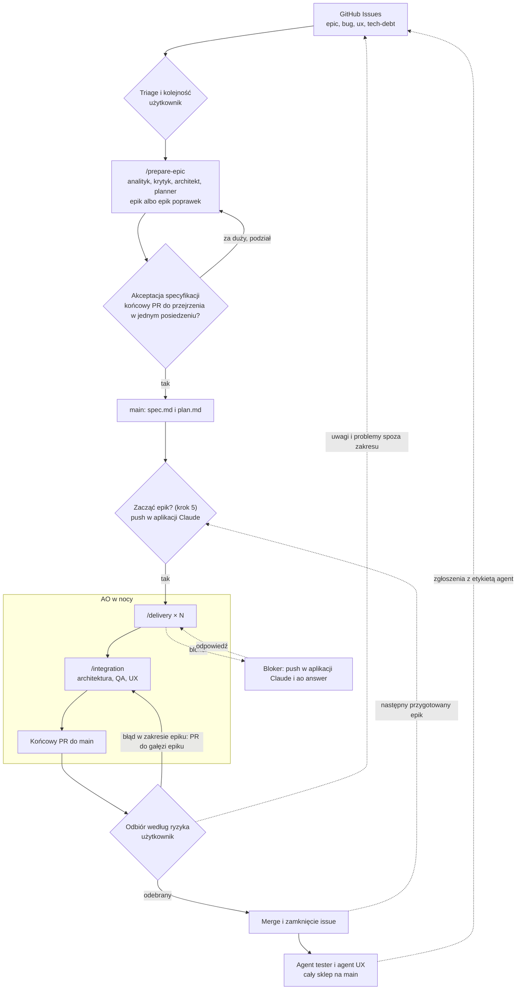

# Plan: Agentic Software House

Docelowa architektura i zasady: [ADR](../../adr/agentic-software-house.md). Ten plan ustala role, proces pracy
i kroki wdrożenia. AO jest zamrożone po v0.3.1: zmienia się tylko wtedy, gdy prawdziwy przebieg epiku stoi,
najmniejszą poprawką i za zgodą użytkownika. Nowe role powstają jako skille i agenci w `shop`, bez kodu AO.

Cel: użytkownik poświęca około godziny dziennie na decyzje, a agenci budują sklep według „Zakresu MVP”
z [wizji](../../vision.md). Godzina dziennie to cel do zmierzenia (krok 7), nie potwierdzony fakt.

## Status

W toku: brak. Następny krok: krok 7. Blokery: brak. CART przeszedł przez AO przed krokami 3–5: 0 interwencji,
odbiór końcowego PR pominięty, uwagi po nim są w issues #80–#85. Pierwszy epik przez cały proces (krok 7) to
CART-FIXES (#88), pierwszy na tablicy backlogu. Nie był jeszcze przygotowany: będzie pierwszym epikiem
przygotowanym przez `/prepare-epic`.

| Krok | Zakres | Status |
|---|---|---|
| 1 | AO v0.3.1 i zamrożenie AO | zrobione |
| 2 | Ten plan, zasada backlogu w `CLAUDE.md` i ADR | zrobione |
| 3 | Poprawki procesu w `shop` | zrobione |
| 4 | Backlog w GitHub Issues | zrobione |
| 5 | Powiadomienia i kolejka epików przez aplikację Claude | zrobione (sprawdzenie w kroku 7) |
| 6 | Przygotowanie epiku jednym skillem `/prepare-epic` | zrobione |
| 7 | Pierwszy epik przez cały proces | do zrobienia |
| 8 | Nocna kolejka kilku epików | do zrobienia, po pomiarze z kroku 7 |
| 9 | Agent tester i agent UX | do zrobienia |
| 10 | Przed publicznym demo: bezpieczeństwo i wydajność | do zrobienia |
| 11 | Po MVP: release i monitoring | do zrobienia |

## Role

Testerów i projektantów UX nie zatrudniamy: obie role pełnią agenci. Człowiekiem jest tylko właściciel produktu.

| Dział | Rola | Kto | Stan |
|---|---|---|---|
| Produkt | Właściciel produktu: co budujemy, kolejność, triage, odbiór | użytkownik | działa |
| Analiza i projekt | Analityk: specyfikacja | `/brainstorm` z użytkownikiem, w `/prepare-epic` | działa |
| | Krytyk specyfikacji: braki, sprzeczności, przypadki brzegowe | `spec-critic` w `/prepare-epic` | działa |
| | Architekt: review specyfikacji | `architecture-reviewer` w `/prepare-epic` | działa |
| | Architekt: ADR, review architektury epiku | `architecture-reviewer` w `/integration` | działa |
| | UX: ekrany, wersja mobilna, dostępność | agent UX | krok 9 |
| Planowanie | Plan i zadania | `/planner`, w `/prepare-epic` | działa |
| | Koordynacja: przebieg nocny, stan, PR | AO | działa |
| | Kolejka epików: następny epik po merge'u | `/ao-run` w sesji z Remote Control | działa, sprawdzenie w kroku 7 |
| Wytwarzanie | Developer: zadanie z TDD | `developer` w `/delivery` | działa |
| | Code review zadania | `code-reviewer` w `/delivery` | działa |
| Jakość | QA epiku | `qa-adversarial` w `/integration` | działa |
| | Tester całego sklepu | agent tester | krok 9 |
| | Bezpieczeństwo i wydajność | ustalane w kroku 10 | krok 10 |
| Wydanie i utrzymanie | Release na publiczne demo, rollback | k3s i Argo CD z `docs/vision.md` | krok 11 |
| | Monitoring → issues | Sentry i Grafana Cloud z `docs/vision.md` | krok 11 |

## Proces

Stały proces każdego epiku. Elementy, które jeszcze nie działają, mają w nawiasie numer kroku wdrożenia.

1. **Backlog: GitHub Issues** w `piotrp321/shop`.
   - Etykieta `epic` to funkcja z „Zakresu MVP”, `bug` to błąd, `ux` to problem użyteczności albo wyglądu,
     `tech-debt` to porządki w kodzie, bazie albo dokumentacji bez zmiany zachowania.
   - Zgłaszają: użytkownik, agent tester i agent UX (krok 9). Zgłoszenia agentów mają etykietę `agent` i limit
     na jeden przebieg. Do backlogu trafiają dopiero po triage użytkownika.
   - Zgłoszenia `bug`, `ux` i `tech-debt` mają pola: środowisko, kroki odtworzenia (jeden krok w linii), wynik
     oczekiwany i faktyczny, kryterium akceptacji, niewiadome. Dla `bug` i `ux` jest formularz
     w `.github/ISSUE_TEMPLATE/`, agenci wypełniają te same pola. Zgłoszenie z brakami dostaje etykietę
     `needs-info` i nie idzie do przygotowania.
   - Kolejność ustala użytkownik na tablicy GitHub Projects
     [„Backlog sklepu”](https://github.com/users/piotrp321/projects/1): epik na górze idzie pierwszy.
2. **Przygotowanie (użytkownik, w dzień).**
   - Issue z góry listy → `/prepare-epic` → `spec.md` i `plan.md`.
   - `/prepare-epic` prowadzi kolejno:
     - analityka według zasad `/brainstorm`: discovery i szkic specyfikacji;
     - krytyka i `architecture-reviewer`: sprawdzają szkic, nie użytkownika;
     - poprawki techniczne w szkicu;
     - `/planner`.
   - Decyzje produktowe (zakres, reguły, limity, zachowanie klienta) podejmuje wyłącznie użytkownik. Agenci ich
     nie rozstrzygają między sobą. Zbierają je w jedną listę pytań, każde z rekomendacją. Użytkownik dostaje
     pytania raz, przed akceptacją.
   - Akceptacja jest jedna: specyfikacja i jedno pytanie, czy końcowy PR da się przejrzeć w jednym posiedzeniu.
     Skill podaje do tego liczbę zadań i dotknięte aplikacje. Jeśli PR jest za duży, epik dzielimy na dwa,
     mergowane po kolei. Rozmiar pojedynczych zadań zostaje bez zmian. Podziału na zadania użytkownik nie
     akceptuje: `plan.md` musi przejść walidator manifestu.
   - Przygotowujemy jeden epik do przodu: gdy AO w nocy robi epik N, w dzień przygotowujemy N+1 (krok 8 może to
     zmienić na tyle epików, ile mieści noc). Nie przygotowujemy wszystkich epików naraz, bo specyfikacja opisuje kod, którego jeszcze nie ma.
   - Zgłoszenie `ux` zawsze idzie przez `/prepare-epic`. Drobne zgłoszenia `bug`
     i `tech-debt` trafiają razem do jednego epiku poprawek: krótka specyfikacja, jedno zadanie na issue.
   - Zaakceptowane `spec.md` i `plan.md` trafiają do `main` przez PR, który `/prepare-epic` merguje po zielonym CI.
3. **Wykonanie (AO, w nocy).**
   - Start epiku (krok 5): sesja z Remote Control bierze następny epik z tablicy, który ma zaakceptowane
     `spec.md` i `plan.md` na `main`, i pyta w powiadomieniu push „Zacząć epik X?”. Pyta po merge'u poprzedniego
     epiku albo na prośbę użytkownika. Bez zgody niczego nie uruchamia. Na raz trwa jeden epik.
   - Sesja z `/ao-run <epik>` uruchamia `ao epic start` i `ao run --until-idle`. AO prowadzi zadania przez
     `/delivery` po jednym naraz, squash-merguje je do `epic/<epik>`, uruchamia `/integration` i otwiera końcowy
     PR `epic/<epik>` → `main` z raportem `ao report`.
   - `code-reviewer` w `/delivery` sprawdza każde zadanie, a `/integration` cały epik. Usunięty, wyłączony albo
     osłabiony istniejący test lub zmieniona wartość oczekiwana bez podstawy w specyfikacji to `BLOCKER` w zadaniu
     i `Important` w epiku. Plik albo zmiana spoza `scope` zadania to zgłoszenie. `code-reviewer` sprawdza też,
     czy RED poprzedził implementację.
   - Przy epikach, które zmieniają `apps/store` albo `apps/admin`, `/integration` uruchamia też agenta UX
     (krok 9). Problem z zakresu epiku jest znaleziskiem do naprawy, pozostałe zostają w raporcie jako uwagi.
4. **Blokery.**
   - `BLOCKED` i powiadomienie w aplikacji Claude na telefonie tylko wtedy, gdy zadanie nie może iść dalej bez
     decyzji. Użytkownik odpowiada w sesji, która prowadzi przebieg, a ta wykonuje `ao answer`.
   - Wybory odwracalne agent rozstrzyga sam i wpisuje do sekcji „Decyzje bez pytania” w opisie PR zadania, a
     `/integration` przenosi je do swojego raportu.
   - Powtarzający się bloker naprawiamy w `/brainstorm` albo w `CLAUDE.md`, nie w AO.
5. **Odbiór (użytkownik).**
   - Odbiór to przeczytanie raportu odbioru z `/ao-run` i merge. Raport ma rekomendację „merge” albo „najpierw
     sprawdź: …”, zbudowaną z „Listy odbioru” raportu `/integration` (ścieżka raportu jest w opisie końcowego PR):
     dla każdej pozycji „OK” albo „Sprawdź”, czyli zmiany istniejących testów, migracje, pliki spoza zakresów zadań,
     odstępstwa od specyfikacji i „Decyzje bez pytania”.
   - Błąd w zakresie epiku: poprawka przez PR do `epic/<epik>` (np. `/delivery` uruchomione ręcznie z linią
     `Gałąź docelowa PR: epic/<epik>`), zmergowany przez użytkownika po zielonym CI. AO traktuje nowy HEAD jako
     kod po przeglądzie: robi rundę `DELTA` `/integration`, a końcowy PR czeka na jej wynik. Potem odbiór od nowa.
     Taka poprawka liczy się jako ręczna.
   - Problem spoza zakresu albo większy: nowe issue `bug` lub `ux`. Epik mergujemy bez tej poprawki, o ile
     niczego na `main` nie psuje. Uwagi `Minor` z raportu `/integration`, które warto zrobić, też stają się
     issues.
   - Użytkownik dopisuje `Closes #N` każdego issue epiku do opisu końcowego PR i merguje go (squash). Issue
     zamykają się same. Merge do `main` zostaje wyłącznie u użytkownika.
   - Po każdym epiku trzy liczby w komentarzu do issue epiku: minuty użytkownika (spec, blokery, triage, raport),
     liczba interwencji (z `ao report`) i liczba ręcznych poprawek.
6. **Po merge'u (krok 9).** Agent tester i agent UX przechodzą cały sklep na świeżym stosie z `main`: krytyczne
   ścieżki z sekcji „Testy” w `docs/vision.md` i nową funkcję ze specyfikacji, jako klient i jako pracownik.
   Przed założeniem zgłoszenia sprawdzają otwarte issues, żeby nie dublować. Zgłoszenia trafiają do triage
   (punkt 1).

## Kroki wdrożenia

1. **AO v0.3.1 i zamrożenie.** v0.3.1 zamknięte (piotrp321/agentic-orchestrator#32). Od teraz AO jest zamrożone.
2. **Plan i zasada backlogu.** Ten plan zastępuje poprzedni. `CLAUDE.md` dostaje zasadę backlogu, ADR wskazuje
   GitHub Issues jako intake i opisuje role agenta testera i agenta UX. Jeden PR.
3. **Poprawki procesu w `shop`.** Formularze `bug` i `ux` w `.github/ISSUE_TEMPLATE/`, kontrole istniejących
   testów, zakresu i RED w `code-reviewer`, sekcja „Decyzje bez pytania” w PR zadań i lista odbioru w raporcie
   `/integration`.
4. **Backlog.** Etykiety `epic`, `bug`, `ux`, `tech-debt`, `needs-info` i `agent` są założone. Epiki z niezrobionych
   punktów „Zakresu MVP” to issues #88–#97, w kolejności na tablicy „Backlog sklepu”.
5. **Powiadomienia i kolejka epików przez aplikację Claude.** Przebieg AO prowadzi sesja Claude Code z Remote
   Control (włączone globalnie w aplikacji). Sesja śledzi zdarzenia AO (bloker, awaria, koniec epiku) i wysyła
   powiadomienie push do aplikacji Claude na telefonie. Odpowiedź na bloker użytkownik pisze w tej sesji, a sesja
   wykonuje `ao answer`. Po merge'u końcowego PR ta sama sesja bierze następny przygotowany epik z tablicy i pyta
   „Zacząć epik X?” (punkt 3 procesu). Instrukcja dla sesji jest w `shop`, bez zmian w kodzie AO. Mechanizm sprawdza
   pierwszy przebieg (krok 7). Przebieg epiku prowadzi skill `/ao-run <epik>` (`docs/features/ao-run/spec.md`).
   Kolejkę prowadzi ten sam skill (sekcja „Następny epik”, `next_epic.py`): `/ao-run` bez argumentu wybiera
   następny przygotowany epik z tablicy.
6. **Przygotowanie epiku jednym skillem.** Skill `.claude/skills/prepare-epic/` i agent krytyka `spec-critic`
   w `shop`, bez zmian w AO (specyfikacja: `docs/features/prepare-epic/spec.md`):
   - kolejność i podział ról jak w punkcie 2 procesu, zasady analityka i podziału na zadania brane z `/brainstorm`
     i `/planner`; oba skille zostają do pracy poza epikami;
   - jedna lista pytań produktowych do użytkownika i jedna akceptacja specyfikacji z pytaniem o rozmiar PR;
   - PR ze `spec.md` i `plan.md` merguje skill po akceptacji i zielonym CI; wyjątki merge'ów w `CLAUDE.md` i ADR.
7. **Pierwszy epik.** Issue z góry backlogu przechodzi cały proces, od `/prepare-epic` do odbioru, razem z pomiarem
   z punktu 5 procesu. Każdy kolejny epik idzie tym samym procesem.
8. **Nocna kolejka kilku epików.** Rusza po pomiarze z kroku 7, gdy wiemy, ile trwa cały epik i ile minut zajmuje
   odbiór. Przed snem użytkownik jedną zgodą zatwierdza listę przygotowanych epików na noc. Po `epic_done` jednego
   epiku sesja z `/ao-run` startuje następny z listy, bez czekania na merge. Rano użytkownik odbiera kilka raportów.
   Najpierw specyfikacja (zmiana `docs/features/ao-run/spec.md`), potem zmiany w `shop`, bez zmian w AO:
   - na jedną noc trafiają tylko epiki o rozłącznym zakresie, bo każdy startuje z `main` bez poprzednich;
     `/prepare-epic` zapisuje zakres epiku (aplikacje i moduły), a kolejka sprawdza rozłączność;
   - przygotowanie tylu epików do przodu, ile mieści noc, zamiast jednego (punkt 2 procesu);
   - następny epik nie rusza, gdy limit subskrypcji nie wystarczy na cały jego przebieg;
   - liczba epików na noc wynika z pomiaru, nie z założenia;
   - punkt zatrzymania „Start epiku” zmienia się w tym samym PR co skill.
9. **Agent tester i agent UX.** Rusza po kroku 7, gdy lista odbioru zadziała na prawdziwym epiku.
   Najpierw specyfikacja przez `/brainstorm`, potem skille i agenci w `shop`:
   - agent tester po merge'u epiku (punkt 6 procesu);
   - agent UX po merge'u i jako trzeci reviewer w `/integration` (punkt 3 procesu);
   - etykieta `agent`, limit zgłoszeń na przebieg, sprawdzanie duplikatów;
   - do czasu makiet z punktu 3 „Zakresu MVP” agent UX ocenia tylko użyteczność i dostępność, nie zgodność
     z projektem wizualnym;
   - na start uruchamia ich użytkownik jedną komendą po merge'u, automatyczne uruchamianie dopiero wtedy, gdy
     zgłoszenia okażą się warte czasu triage.
10. **Przed publicznym demo: bezpieczeństwo i wydajność.** Przegląd bezpieczeństwa całego sklepu i testy
   obciążeniowe względem „Wymagań niefunkcjonalnych” z `docs/vision.md`. Zakres i narzędzia ustala specyfikacja
   przed demo.
11. **Po MVP: release i monitoring.** Publiczne demo zgodnie z `docs/vision.md` (k3s, Argo CD, rollback). Błędy
   z Sentry i alerty z Grafana Cloud stają się issues `bug` z etykietą `agent` i przechodzą triage.

Proces i kontrakt trafiają do ADR, gdy krok 7 potwierdzi, że działają. Plan usuwamy po ostatnim kroku.

## Świadomie poza planem

Skrzynka decyzji (zamiast niej powiadomienia w aplikacji Claude i `ao answer`), polityka autonomii jako plik, AO jako demon launchd, kilka
zadań naraz i pula środowisk, budżet na funkcję, merge queue, automatyczne zamienianie issue w zadania, metryki
i evale skilli, agent decydujący o produkcie, automatyczny merge kodu do `main`, rój agentów pracujących równolegle,
`/planner` wewnątrz `/delivery` (jeden PR na epik bez review zadań), przygotowanie wszystkich epików naraz.
Wracają tylko wtedy, gdy przebiegi pokażą, że czegoś z tego brakuje, i użytkownik o tym zdecyduje.

## Kontrakt planu i backlogu

Styk backlog → `/planner` → AO → `/delivery`. Format manifestu i jego walidator są w `.claude/skills/planner/`
(`schema_version: 1`). Szczegóły po stronie AO opisuje README `piotrp321/agentic-orchestrator`.

1. **Jedno źródło na rodzaj danych.** Co budujemy i w jakiej kolejności: issue. Definicja zadania (ID, tytuł,
   zakres, kryteria akceptacji, ryzyko, zależności, specyfikacja): tylko manifest. Stan zadania (kolejka, próby,
   PR, blokery): tylko AO. AO nie zapisuje niczego w repozytorium, `/planner` nie zgłasza zadań do AO, issue nie
   zawiera definicji zadań.
2. **Plan wiążący = plan na `origin/main`.** Zaakceptowany plan i jego specyfikacja trafiają do `main` przed
   `ao submit-plan`, więc każda gałąź zadania zawiera specyfikację. AO czyta plan z commita, nie z dysku, i
   zapamiętuje jego SHA. Plan z innej gałęzi na `origin` AO przyjmuje tylko na jawne wskazanie (`--base`).
3. **Zmiana planu po imporcie.** Ponowne `ao submit-plan` z tym samym planem niczego nie zmienia. Epik
   zarejestrowany z innego commita planu albo z inną konfiguracją kończy się odmową. Plan zmieniony po akceptacji
   wymaga ponownej akceptacji (zasada `/planner`).
4. **Gotowość zadania zależnego.** Zadanie rusza, gdy wszystkie jego zależności są `MERGED` do `epic/<epik>`. AO
   sprawdza to w GitHubie (`gh pr view`) i promuje zadanie sam, od aktualnego `origin/epic/<epik>`.
5. **Wejście `/delivery`.** AO przekazuje ID zadania, ścieżkę `plan.md` i gałąź docelową PR (`epic/<epik>`).
   `/delivery` czyta swoje zadanie z manifestu na commicie bazowym, a specyfikację z pola `spec`. `risk`
   z manifestu to podpowiedź, wiąże klasyfikacja `/delivery`.
6. **Wersjonowanie.** Każda zmiana pól manifestu podnosi `schema_version` i wymaga zmiany walidatora `/planner`
   i AO w tej samej fali prac. AO odrzuca nieznaną wersję. AO sprawdza tylko pola, których używa, pełny format
   sprawdza walidator w `shop`.

## Punkty zatrzymania

- **Każdy epik:** przed `ao submit-plan` użytkownik akceptuje w `/prepare-epic` specyfikację i rozmiar końcowego PR,
  a `plan.md` przechodzi walidator manifestu.
- **Start epiku:** AO rusza z epikiem dopiero po „tak” użytkownika na pytanie „Zacząć epik X?”.
- **Merge do `main`:** końcowy PR epiku merguje wyłącznie użytkownik. Wyjątek: PR ze `spec.md` i `plan.md`
  z `/prepare-epic`, który skill merguje po akceptacji użytkownika i zielonym CI. Każde rozszerzenie
  autonomii wymaga jego jawnej zgody.
- **Zmiana AO:** tylko przy zablokowanym prawdziwym przebiegu, za zgodą użytkownika.
- **Krok 4:** issues epików powstają dopiero po akceptacji listy.
- **Kroki 8–11:** specyfikacja każdego kroku zaakceptowana przed implementacją.
- **Zgłoszenia agentów:** trafiają do backlogu dopiero po triage użytkownika.
